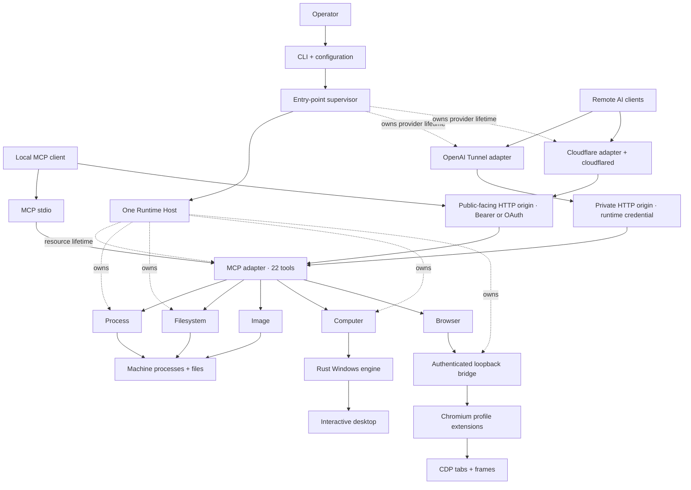
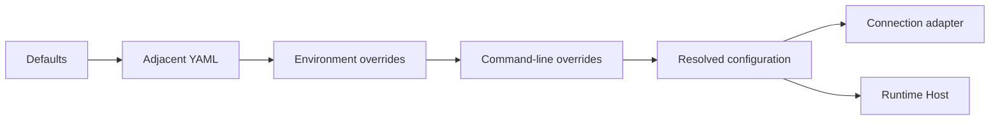
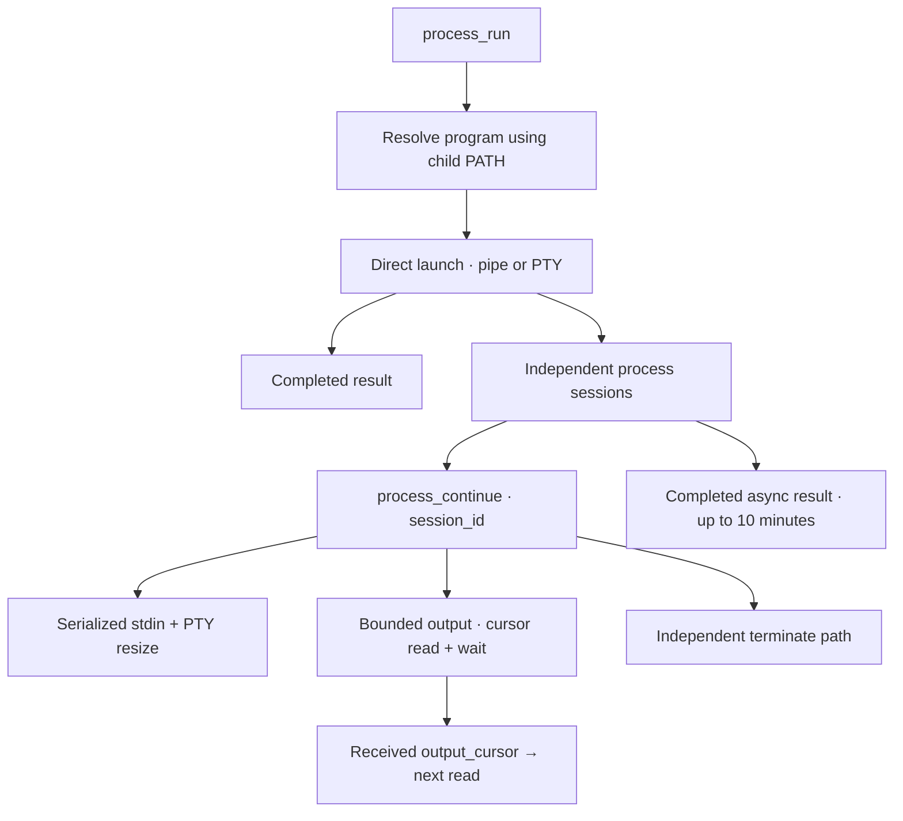
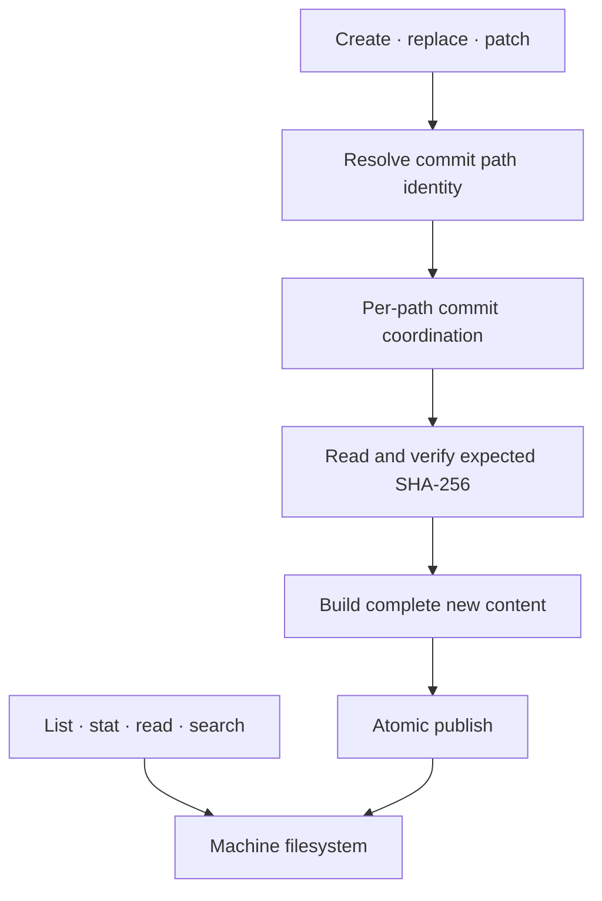
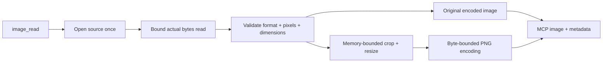
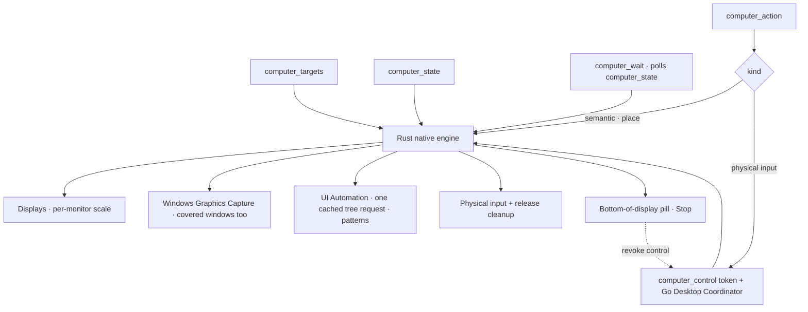
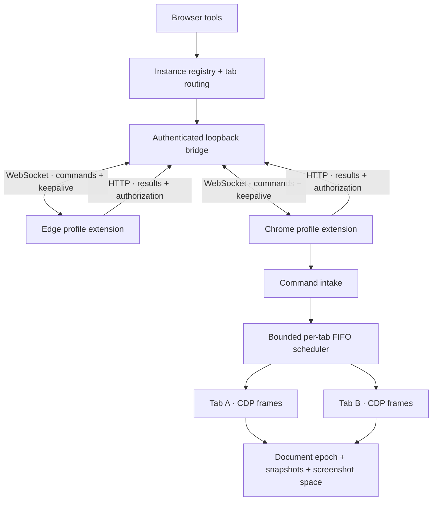

# Local Runtime MCP

[](https://github.com/hicancan/local-runtime-mcp/actions/workflows/ci.yml)
[](https://github.com/hicancan/local-runtime-mcp/releases/latest)
[](LICENSE)
[](https://m8ven.ai/mcp/hicancan/local-runtime-mcp)

**English** · [简体中文](README.zh-CN.md)

Give AI clients the programs, files, images, browser profiles, and desktop of the machine running `lrmcp`. Local Runtime MCP is a unified personal capability runtime with **23 core built-in MCP tools** (including `agent_report` live progress notes), `capability_propose` for distilling reusable webpage tools (Web MCP), and owner-authored local app bindings (App MCP).

`lrmcp` and its paired Chromium extension form one bidirectional dual-core runtime: one persistent user-session daemon owns the OS side (`127.0.0.1:9317`), an embedded pure-Go SQLite WAL + FTS5 audit engine (`lrmcp-audit.db`), and the local-only Sovereign Activity Studio (`lrmcp ui`), while bridging multiple Chromium profiles (`127.0.0.1:9315`). Every local client attaches concurrently over stateless `stdio` thin proxies; remote cloud clients (OAuth or named per-client Bearer tokens under `grants.remote.tokens`) plug and unplug live through OpenAI Secure MCP Tunnel or Cloudflare Tunnel with zero daemon restarts and per-wire remote grants (`grants.remote`). See [v17.0.0 release notes](docs/releases/v17.0.0.md).

Independent process sessions, filesystem paths, and browser tabs run concurrently; shared files and desktop physical input have explicit coordination rules.

- **Native multimodal results.** Files, browser pages, and desktop observations return text and MCP image content directly.
- **Explicit browser targets.** Connect several Chromium profiles, select a named browser instance, and operate its opaque tab handles.
- **Desktop control that leaves you working.** See every display and window, read UI Automation trees with their text, and operate controls through their patterns without the pointer, keyboard or focus. Physical input, when needed, borrows them under a token, shown by a small pill you can click to stop.
- **Portable configuration.** Keep `local-runtime-mcp.yaml`, the executable, and browser integration together on a fixed or removable drive.
- **Independent connection providers.** Enable OpenAI, Cloudflare, or both for the same Runtime Host. Public HTTP supports static Bearer credentials or OAuth authorization with owner approval.
- **Platform-specific engines.** Go hosts the runtime and MCP adapters; Rust implements Windows capture, UI Automation, and input; TypeScript implements Chromium integration.

## Architecture

The connection layer delivers MCP requests. The capability layer defines machine operations. One Runtime Host owns the resources shared by every enabled entry point and client of a running instance.



Solid arrows show request flow; dotted arrows show lifetime ownership. Text and images travel as MCP content. OpenAI's private origin and the public-facing HTTP origin publish the same MCP Server while retaining their respective authentication boundaries. Cloudflare reaches the public origin over loopback; its external URL uses HTTPS.

| Layer | Responsibility |
| --- | --- |
| CLI and configuration | Select entry points explicitly and resolve configuration once. |
| Entry-point supervisor | Own provider lifetimes, report exits, and keep surviving entry points available. |
| Connection adapters | Deliver requests through stdio, HTTP, or a tunnel provider to the shared Server. |
| MCP adapter | Publish tool schemas, validate inputs, and encode results. |
| Capability services | Define resource identities, observations, actions, and concurrency. |
| Platform backends | Execute OS operations, Windows native interaction, and Chromium CDP commands. |

The Host creates one Process Manager, Filesystem Service, Browser Bridge, and Computer Controller. A provider failure affects that entry point; the Host and other live entry points continue. When all entry points finish, or the operator interrupts the runtime, shutdown stops admission, cancels pending work, cleans up managed processes and input, and closes listeners and helpers. Individual request failures retain the running Host and its other resources. Recovery restores connectivity without replaying machine actions.

### Commands and transports

```text
lrmcp
├── serve --transport stdio [--agent NAME] Pure stdio thin proxy (auto-starts detached daemon)
├── start [--http] [--tunnel ...]        Ensure detached user-session daemon is running
├── stop                                 Gracefully stop the running daemon
├── status                               Inspect live daemon, browser profiles, and wires
├── daemon [--http] [--tunnel ...]       Run unified daemon in foreground
├── tunnel
│   ├── up <openai|cloudflare|http> [--ttl 2h]
│   ├── down <openai|cloudflare|http|all>
│   └── status
├── grant remote <openai|http> [--read-only] [--tool NAME]
├── ui [--no-open]                       Open local Sovereign Activity & Audit Studio
├── audit
│   ├── list [--limit N]
│   ├── events [--session ID] [--agent ID]
│   ├── search <query>
│   ├── tail [--agent ID]
│   └── export [--session ID] [--output FILE]
├── setup
│   ├── browser
│   ├── local
│   ├── client
│   ├── oauth
│   └── remote-token
├── version
└── help
```

One detached user-session daemon owns the OS runtime (`127.0.0.1:9317`) and browser extension bridge (`127.0.0.1:9315`). When `local.token` is configured (`lrmcp setup local`), the first `lrmcp serve --transport stdio` client automatically spawns the detached daemon and attaches as a stateless thin proxy; closing any IDE never stops the daemon or disconnects other clients. Remote wires (`openai`, `cloudflare`, `http`) plug and unplug live without restarting the daemon.

| Command | Behavior and credentials |
| --- | --- |
| `lrmcp serve --transport stdio` | Pure MCP stdio thin proxy; auto-spawns the detached daemon if not yet running and attaches to `127.0.0.1:9317/mcp/attach` (isolated in-process host if `local.token` is unset). |
| `lrmcp start [--http] [--tunnel openai\|cloudflare] [--ttl 2h]` | Ensures the background user-session daemon is running and optionally attaches remote wires. |
| `lrmcp stop` | Gracefully shuts down the running daemon via `127.0.0.1:9317/admin/shutdown`. |
| `lrmcp status` | Prints live daemon PID, attached stdio clients, browser profiles, desktop lock, capability counts, and remote wire states. |
| `lrmcp daemon [--http] [--tunnel ...]` | Runs the unified daemon in the foreground. |
| `lrmcp tunnel up openai [--ttl 2h]` | Ensures daemon is running and hot-plugs OpenAI Secure MCP Tunnel on its private loopback hop (zero restart, optional auto-expiry lease). |
| `lrmcp tunnel up cloudflare [--ttl 2h]` | Hot-plugs public loopback HTTP (`127.0.0.1:9316`) and `cloudflared` (zero restart). |
| `lrmcp tunnel down openai\|cloudflare\|http\|all` | Hot-unplugs one or all remote wires live; local clients and browser sessions continue uninterrupted. |
| `lrmcp grant remote openai\|http [--read-only] [--tool NAME]` | Constrains what a remote wire may list and invoke; live-updates connected clients via `tools/list_changed`. |
| `lrmcp ui [--no-open]` | Ensures the daemon is running, mints a single-use 60s bootstrap link, and opens the embedded local Activity Studio (`http://127.0.0.1:9317/ui/`). |
| `lrmcp audit list \| events \| search \| tail \| export` | Query, FTS5 full-text search, live-tail over SSE, or export the embedded SQLite WAL audit log as JSONL. |
| `lrmcp setup browser` | Generate bridge credentials and extract/configure the extension. |
| `lrmcp setup local` | Generate `local.token` for multi-client detached daemon sharing on `127.0.0.1:9317`. |
| `lrmcp setup client --id NAME [--browser-id ID]` | Register a scoped local native client in `grants.clients` (`--show` displays credentials). |
| `lrmcp setup oauth --client-name NAME --redirect-uri URI` | Register an OAuth client with its exact callback URI and generate credentials. |
| `lrmcp setup remote-token --id NAME [--read-only] [--tool NAME]` | Mint an independent named Bearer token under `grants.remote.tokens` for multi-client cloud access on `9316` (coexists with OAuth). |
| `lrmcp setup oauth --show` | Display existing OAuth credentials deliberately in the local terminal. |
| `lrmcp version` | Print the executable version. |
| `lrmcp help` | Show commands and flags. |

OpenAI starts its private endpoint on a dynamically assigned loopback port and uses a fresh, in-memory private-hop credential. Cloudflare uses the configured public-facing loopback origin and its maintained companion executable. Domain services remain independent of either provider. A second machine runs its own Host and uses a distinct connection address; independent machines have independent resources and handles.

### Configuration



Precedence is **command line > environment > YAML > defaults**. The file path is always `<lrmcp directory>/local-runtime-mcp.yaml`. Configuration validation covers the components selected for this invocation. Browser instance identity belongs to each browser profile's extension storage; process, tab, and desktop observation handles belong to the current runtime lifecycle.

## Capability domains

| Domain | Tools |
| --- | ---: |
| Process | 2 |
| Filesystem | 6 |
| Image | 1 |
| Computer | 5 |
| Browser | 8 |
| Activity (`agent_report`) | 1 |
| **Total** | **23** |

### Process · 2 tools



- `process_run` accepts `program`, argument array, working directory, environment overrides, initial stdin, execution timeout, output limits, and pipe or PTY I/O.
- `process_continue` reads retained output from explicit byte offsets, writes stdin, closes pipe input, resizes a PTY, waits, or terminates a managed session.

Bare program names use the merged child `PATH` in both I/O modes; Windows also uses `PATHEXT`. Explicit relative executable paths resolve against the requested working directory. To execute shell syntax, launch the desired shell explicitly with its arguments.

Different sessions run concurrently. Within one session, input writes are serialized and output reads preserve the bounded stdout and stderr buffers. Waiting for output leaves termination available, including when stdin is blocked. Output and queued input are bounded; a single stdin payload is limited to 16 MiB.

Each result includes `output_cursor: {stdout, stderr}` with the next byte offsets. Pass the last successfully received cursor to `process_continue` to collect only new output. Omitting the cursor starts at zero and rereads the retained output. The returned `stdout_offset` and `stderr_offset` identify the actual start of each stream; a truncation flag indicates that the requested prefix has aged out of its buffer. Completed asynchronous sessions remain readable for up to ten minutes. Under capacity pressure, the oldest completed session makes room for a new process; active sessions keep their place.

If a pure-read response is lost, repeat `process_continue` with the same `session_id` and cursor. The response can include output produced since the previous attempt. Advance the cursor and append output only after receiving a successful result. Calls that start a process or change stdin, PTY size, or process lifetime require checking the resource before retrying after an uncertain response. A lost initial launch response may leave the client without a session ID.

`duration_ms` is elapsed process time while the program runs and its fixed lifetime after exit. Collecting a completed session later leaves that duration unchanged.

Cancellation delivered to `process_run` before it returns a live session terminates and collects that process. Cancellation delivered to `process_continue` stops that call's wait; use `terminate=true` to end the session. HTTP disconnect cancellation follows the negotiated MCP protocol: SDK request-context propagation applies to protocol `2026-07-28` and newer; older stateless requests may finish their bounded wait after the client disconnects. Execution timeout and Host shutdown terminate managed processes independently of the MCP request deadline.

### Filesystem · 6 tools



| Tool | Operation |
| --- | --- |
| `filesystem_list` | Bounded directory traversal. |
| `filesystem_stat` | File metadata and optional SHA-256. |
| `filesystem_read_text` | UTF-8 line ranges with byte and line limits. |
| `filesystem_search_text` | Literal text or Go-regexp search. |
| `filesystem_write_text` | Explicit `mode=create` or `mode=replace`. |
| `filesystem_patch_text` | Version-checked, uniquely anchored contextual hunks. |

`create` publishes a complete file only if the destination is absent. `replace` requires an existing file and `expected_sha256`. Patches also require the expected hash and resolve all hunks against one immutable source version.

Text reads return complete lines. When the first selected line exceeds the byte budget, the call returns a bounded error; after earlier complete lines it reports truncation and the next line. Skipped lines are scanned with bounded memory, and requested SHA-256 values cover the entire file through streaming reads.

The Filesystem Service holds one path's commit lock from version validation through publication. Different paths and read operations remain concurrent. Final-component symbolic links are rejected for mutation; existing parent aliases are normalized for coordination.

These locks coordinate calls made through this Host. External editors and invoked programs retain their own access to the filesystem. Concurrent coding tasks can use separate Git worktrees to separate indexes and build outputs.

### Image · 1 tool



`image_read` supports PNG, JPEG, GIF, and WebP, returning native MCP image content with actual source bytes and dimensions. Optional crop and proportional resize produce PNG output. Encoded reads, pixel counts, dimensions, decoded transformation memory, and output encoding are bounded. Capacity waits respect request cancellation.

Image reading is stateless. Browser and Computer captures carry their own observation identities and coordinate semantics.

### Computer · 5 tools



The person at the computer keeps working while an agent does. Observation, waiting, semantic actions and window placement never touch the pointer, the keyboard or the foreground window; only physical input borrows them.

```text
computer_targets(process="StuDev") → displays + windows (target_id)
computer_state(target_id=..., image=false, automation_id="map") → ref_id
computer_action(kind="invoke", element_ref=...)            # no control, no focus change
computer_wait(target_id=..., name="搜地点", until="present") → fresh ref_ids
computer_state(target_id=...) → pixels of the window even while it is covered
computer_action(kind="place", target_id=..., bounds={...})  # resize without activating
```

- `computer_targets` returns every display (ID, bounds, work area, scale, primary) and the visible top-level windows: opaque target ID, process, title, class, visible frame without the invisible resize borders, normal/minimized/maximized state and display. Cloaked windows are left out. Filter by `pid`, `title` or `process`.
- `computer_state` observes one window, one display or every display. Windows are captured through Windows Graphics Capture, so a window covered by others, including GPU swap-chain content, is captured as it is drawn. For a window it also returns the UI Automation tree, fetched in one cached cross-process request: role, name (text included), AutomationId, class, value or toggle/selection/expansion state, bounds, depth and parent, disabled/offscreen/focused, and the supported patterns. `elements` chooses all, interactive or none; `name`, `automation_id` and `role` filter; `max_elements` and `offset` page. `region` crops, `image=false` skips pixels, `cursor=true` draws the pointer.
- `computer_wait` polls a window's tree without pixels until an element matching `name`, `automation_id` or `role` is present or absent, then returns that observation and whether the condition was met.
- `computer_action` semantic kinds operate an element by `element_ref` through its pattern: `invoke`, `toggle`, `select`, `expand`, `collapse`, `set_value`, `scroll_into_view`, `scroll_by` (pages). `place` moves or resizes a window to a visible frame and restores or minimizes it without activating it, across displays of different scale. Physical kinds, `activate`, `move`, `click`, `double_click`, `drag`, `type_text`, `press_key` and `scroll`, need `control_id` and a state observed with it.
- `computer_control` allocates the single pointer and keyboard to one workflow. It has a five-minute idle expiry refreshed by controlled operations; release, expiry, local Stop and shutdown cancel pending work, clear injected input and invalidate actionable observations.

Refs are verified against the element's runtime identity at use, so a ref whose control was replaced fails instead of acting on something else. Physical actions invalidate prior states; semantic actions keep them. Coordinates are relative to an observation's origin, which is in physical virtual-desktop pixels; displays to the left of the primary have negative origins.

While physical control is held, a small translucent pill at the bottom of the display being worked on reads “AI 正在操作 · 点此停止”; clicking it revokes control. It never outlines windows, never takes focus, and is excluded from capture. Nothing is drawn for semantic actions.

### Browser · 8 tools



Install the same MV3 extension in each intended Chromium profile. Give each instance a readable label in extension options, such as `Edge · Work` or `Chrome · Research`. The extension keeps a stable UUID in that profile and connects to the shared bridge using its token. `chrome.debugger` sends CDP operations directly to tabs and frames.

Each profile receives commands over one authenticated loopback WebSocket and exchanges keepalive messages every 20 seconds. A browser alarm restores interrupted connections. Results and desktop-operation authorization use authenticated HTTP on the same bridge. This connection remains active while browser tasks are idle, following Chromium's [extension service-worker WebSocket lifecycle](https://developer.chrome.com/docs/extensions/how-to/web-platform/websockets).

| Tool | Target and operation |
| --- | --- |
| `browser_status` | List named browser instances and their connection health. |
| `browser_tabs` | Select `browser_id` and discover tabs. |
| `browser_open` | Select `browser_id`; open a tab, with `active=false` by default. |
| `browser_close` | Close an opaque `tab_id`. |
| `browser_navigate` | URL, back, forward, or reload for `tab_id`. |
| `browser_snapshot` | Bounded accessibility text and versioned element refs across frames. |
| `browser_screenshot` | Viewport, full-page, or clipped PNG for `tab_id`. |
| `browser_action` | Ref- or screenshot-targeted input, forms, files, dialogs, and JavaScript evaluation. |

Copy `browser_id` from status and the opaque tab `id` from discovery or creation into subsequent `tab_id` arguments. The tab handle includes its instance and lifecycle identity internally; callers treat it as an opaque string. A missing or offline target returns an error, preserving the selected profile. After extension worker restart or reconnect generation change, discover tabs again and acquire fresh observations.

Actions include `click`, `double_click`, `hover`, `drag`, `type_text`, `set_value`, `press_key`, `scroll`, `select`, `check`, `upload_files`, `handle_dialog`, and `evaluate`. Viewport coordinate actions require the matching screenshot ID. Element references belong to the observed document/frame generation; navigation, frame changes, reconnects, and side effects invalidate observations.

Different browser instances and tabs execute concurrently. Operations on one tab are serialized. Queue capacity and execution slots are bounded, and canceled queued work is discarded. Profiles keep their own browser data; tabs in one profile share that profile's sessions, cookies, and accounts.

Browser operations that change the visible desktop coordinate with Computer control. Background tab work remains independent; when a visible operation conflicts with an owned desktop, supply the matching `control_id` or wait until control is released.

## Concurrent workflows

| Resource | Coordination |
| --- | --- |
| Process | Independent sessions; ordered input and replayable cursor reads within retained output. |
| Filesystem | Parallel reads and different paths; serialized version-checked commits on one path. |
| Image | Independent reads within bounded memory and execution capacity. |
| Browser | Explicit instance/tab routing; parallel tabs with FIFO execution per tab. |
| Computer | One desktop input owner; read-only observation remains available. |

For two AI conversations, each can select a different browser instance and open its own background tab. Both can run independent process sessions while one workflow owns desktop input. If both choose the same tab, file, repository, or cloud account, they intentionally share that resource.

Request cancellation is distinct from process execution timeout and Host shutdown. A failed or expired call retains other resources. When a side effect may already have occurred, observe the target before retrying a non-idempotent action.

Transport recovery tests cover failed requests before response headers, incomplete response bodies, protocol-specific cancellation, and transient tunnel poll and response-delivery errors. A surviving peer client and a newly connected client must remain usable after an individual failure. A cloud connection error alone identifies neither the failing hop nor whether the tool executed; diagnosis uses the individual tool name, machine time, and provider logs. Keep credentials and tool payloads private when sharing those logs.

The [two-conversation acceptance prompts](docs/concurrency-acceptance.zh-CN.md) exercise idle browser connectivity, independent process output, explicit profile routing, and desktop ownership through configured clients. The [connection guide](docs/connections.md) covers Gemini OAuth setup and cross-provider acceptance against one Host.

## Installation

Download a platform archive from [Releases](https://github.com/hicancan/local-runtime-mcp/releases/latest), verify its published SHA-256, and extract it into its own directory.

| Platform | Process, Filesystem, Image | Browser | Computer |
| --- | --- | --- | --- |
| Windows amd64 | Supported | Chromium extension | Native Windows engine |
| Linux amd64 / arm64 | Supported | Chromium extension in a desktop browser | Reports platform unavailability |

Browser control requires Chromium 120 or newer and a running profile with the extension loaded. Windows Computer requires Windows 10 version 2004 or newer, including Windows 11, an interactive desktop, and permissions appropriate for the target applications.

The Windows archive contains:

```text
local-runtime-mcp/
├── lrmcp.exe
├── cloudflared.exe
├── config.example.yaml
├── README.md
├── README.zh-CN.md
├── SECURITY.md
├── PRIVACY.md
├── LICENSE
├── THIRD_PARTY_NOTICES.md
├── docs/
├── licenses/
└── cloudflared-LICENSE
```

Copy `config.example.yaml` to `local-runtime-mcp.yaml` and fill the sections used by your selected transport and providers:

```yaml
browser:
  listen: 127.0.0.1:9315
  token: "replace-with-a-random-token-of-at-least-32-characters"

openai:
  tunnel_id: "replace-with-your-openai-tunnel-id"
  api_key: "replace-with-your-openai-tunnel-api-key"

http:
  listen: 127.0.0.1:9316
  public_host: mcp.example.com
  auth: bearer
  bearer_token: "replace-with-a-random-token-of-at-least-32-characters"

cloudflare:
  tunnel_token: "replace-with-your-cloudflare-managed-tunnel-token"
```

Protect the runtime directory as a credential-bearing application directory. Browser profile installation and identity stay with that machine's browser profile when the runtime directory moves.

### Browser setup

```powershell
./lrmcp.exe setup browser
```

The command saves bridge credentials to the adjacent YAML and extracts `browser-extension` beside the executable. In each intended profile, open `edge://extensions` or `chrome://extensions`, enable Developer mode, choose **Load unpacked**, and select that directory. Open extension options to set a distinct label and confirm the bridge address and token. Start `lrmcp` and use `browser_status` to discover connected instances.

### Local stdio

```json
{
  "mcpServers": {
    "local-runtime-mcp": {
      "command": "C:\\Tools\\local-runtime-mcp\\lrmcp.exe",
      "args": ["serve", "--transport", "stdio"]
    }
  }
}
```

### OpenAI Tunnel

Fill the `openai` section, ensure `local.token` is initialized (`./lrmcp.exe setup local`), and hot-plug the wire live (or toggle it directly in the browser extension `L` panel):

```powershell
./lrmcp.exe tunnel up openai --ttl 2h
./lrmcp.exe tunnel down openai
```

See the [OpenAI Secure MCP Tunnel guide](https://developers.openai.com/api/docs/guides/secure-mcp-tunnels) for provider setup and supported clients. The private HTTP origin is created automatically; its port and private-hop credential remain runtime-only.

### Streamable HTTP

For direct loopback HTTP access, choose `http.auth: bearer`, fill `http.bearer_token`, and hot-plug the HTTP wire:

```powershell
./lrmcp.exe tunnel up http
```

The default MCP endpoint is `http://127.0.0.1:9316/mcp`. The loopback listener accepts the configured Bearer token and can serve as a reverse-proxy origin. An OAuth-enabled origin additionally serves discovery, authorization, and token endpoints under its public HTTPS address.

### Cloudflare Tunnel

Create a remotely managed Cloudflare Tunnel, route its hostname to `http://127.0.0.1:9316`, fill `http.public_host` and `cloudflare.tunnel_token`, configure HTTP authentication, then hot-plug Cloudflare:

```powershell
./lrmcp.exe tunnel up cloudflare
```

The release includes the pinned `cloudflared` companion. Configure the remote MCP client to use `https://<public_host>/mcp`. With Bearer authentication, enter the MCP Bearer token in the client's token setting. With OAuth, register that client's redirect URI and use its client credentials. The Cloudflare tunnel token authenticates the tunnel process; HTTP credentials authorize MCP clients.

### Both tunnels

Fill both provider sections and attach both wires onto the same running daemon:

```powershell
./lrmcp.exe tunnel up openai
./lrmcp.exe tunnel up cloudflare
```

Both connections share one browser bridge, process-session registry, filesystem coordination service, and desktop controller. Detaching or restarting either wire never interrupts local `stdio` clients or the surviving peer wire. Use `lrmcp grant remote openai --read-only` or `lrmcp grant remote http --read-only` (or the `L` extension panel) to restrict any remote wire live.

### OAuth for Gemini and other clients

Set `http.public_host` to the externally reachable hostname. In the MCP client's connection dialog, copy its exact redirect URI and register it locally:

```powershell
./lrmcp.exe setup oauth --client-name gemini --redirect-uri "https://<client-callback-host>/<callback-path>"
./lrmcp.exe setup oauth --client-name gemini --show
```

The setup command saves the OAuth client and an owner approval key in the adjacent YAML, and selects `http.auth: oauth`. The show command displays that client's credentials locally. Enter the generated **client ID** and **client secret** in Gemini's additional settings, and use `https://<public_host>/mcp` as its server URL. During authorization, approve access on Local Runtime's consent page using the owner approval key. Keep that approval key with the machine's operator.

OAuth authorization grants access to the runtime's complete machine-control tool surface. Register each client with exact redirect URIs; repeat `--redirect-uri` when one client needs several callbacks. Access and refresh tokens are held in memory. Restarting `lrmcp` requires clients to authorize again. OpenAI's private-hop authentication remains independent of this public HTTP mode.

See [the connection guide](docs/connections.md) for the complete setup sequence, credential roles, and acceptance checks. Real client behavior is verified after connecting that client's account and callback.

### Environment overrides

| Environment variable | YAML field |
| --- | --- |
| `LOCAL_RUNTIME_MCP_BROWSER_LISTEN` | `browser.listen` |
| `LOCAL_RUNTIME_MCP_BROWSER_TOKEN` | `browser.token` |
| `LOCAL_RUNTIME_MCP_LOCAL_LISTEN` | `local.listen` |
| `LOCAL_RUNTIME_MCP_LOCAL_TOKEN` | `local.token` |
| `LOCAL_RUNTIME_MCP_CLIENT_TOKEN` / `LOCAL_RUNTIME_MCP_CLIENT_TOKEN_<ID>` | `grants.clients[].token` |
| `LOCAL_RUNTIME_MCP_REMOTE_TOKEN_<ID>` | `grants.remote.tokens[].token` |
| `LOCAL_RUNTIME_MCP_OPENAI_TUNNEL_ID` | `openai.tunnel_id` |
| `LOCAL_RUNTIME_MCP_OPENAI_API_KEY` | `openai.api_key` |
| `LOCAL_RUNTIME_MCP_HTTP_LISTEN` | `http.listen` |
| `LOCAL_RUNTIME_MCP_HTTP_PUBLIC_HOST` | `http.public_host` |
| `LOCAL_RUNTIME_MCP_HTTP_AUTH` | `http.auth` |
| `LOCAL_RUNTIME_MCP_HTTP_BEARER_TOKEN` | `http.bearer_token` |
| `LOCAL_RUNTIME_MCP_OAUTH_OWNER_TOKEN` | `http.oauth.owner_token` |
| `LOCAL_RUNTIME_MCP_CLOUDFLARE_TUNNEL_TOKEN` | `cloudflare.tunnel_token` |
| `LOCAL_RUNTIME_MCP_CLOUDFLARED` | `cloudflare.binary` |

Run `lrmcp help` for corresponding command-line flags.

## Build and test

Requirements: Go 1.27, Node.js 24, and Rust 1.96.0 with the Windows MSVC toolchain for the Computer engine. CI and release builds pin Rust 1.96.0, and the Windows native worker statically links the Microsoft CRT. Run the native build on Windows with the Visual Studio build environment loaded.

```powershell
Push-Location browser-extension
npm ci
npm run build
npm test
Pop-Location
./scripts/build-native.ps1
cargo fmt --manifest-path native/computer-windows/Cargo.toml --check
cargo clippy --manifest-path native/computer-windows/Cargo.toml --all-targets -- -D warnings
cargo test --manifest-path native/computer-windows/Cargo.toml --locked
go test ./...
go vet ./...
go build ./cmd/lrmcp
```

Go tests cover shared resource lifetimes, provider supervision, HTTP authentication and OAuth flows, response correlation, cancellation, competing file commits, process I/O, and browser identity routing. Extension scheduler tests cover ordering, fairness, cancellation, and queue limits. The opt-in Windows Chromium suite loads the real extension in disposable browser profiles and includes an idle-only connection test:

```powershell
$env:LOCAL_RUNTIME_MCP_BROWSER_E2E = '1'
go test ./internal/browser -run 'TestEdgeExtension(IdleLifecycle|EndToEnd)' -count=3 -v
go test ./internal/browser -run TestEdgeOAuthAuthorizationRedirect -count=3 -v
```

The OAuth browser regression exercises consent, cancellation, incorrect-key retry, cross-origin callback chains, client authentication, and refresh rotation with fixture credentials. CI exercises Windows and Linux. Local protocol and browser tests validate those execution paths; live client acceptance is performed separately against the configured account and tunnel.

## Security, privacy, and license

Authenticated clients operate with the authority of the account running `lrmcp`. Resource handles coordinate targets and workflows within that shared host. Separate tenant permissions require dedicated OS accounts or machines; browser profiles separate browser data.

See [SECURITY.md](SECURITY.md) for deployment guidance and private vulnerability reporting, and [PRIVACY.md](PRIVACY.md) for local storage and provider data flows.

Local Runtime MCP is licensed under [GNU AGPL v3.0 only](LICENSE). The separately licensed `cloudflared` companion and dependency attributions are documented in [THIRD_PARTY_NOTICES.md](THIRD_PARTY_NOTICES.md).
