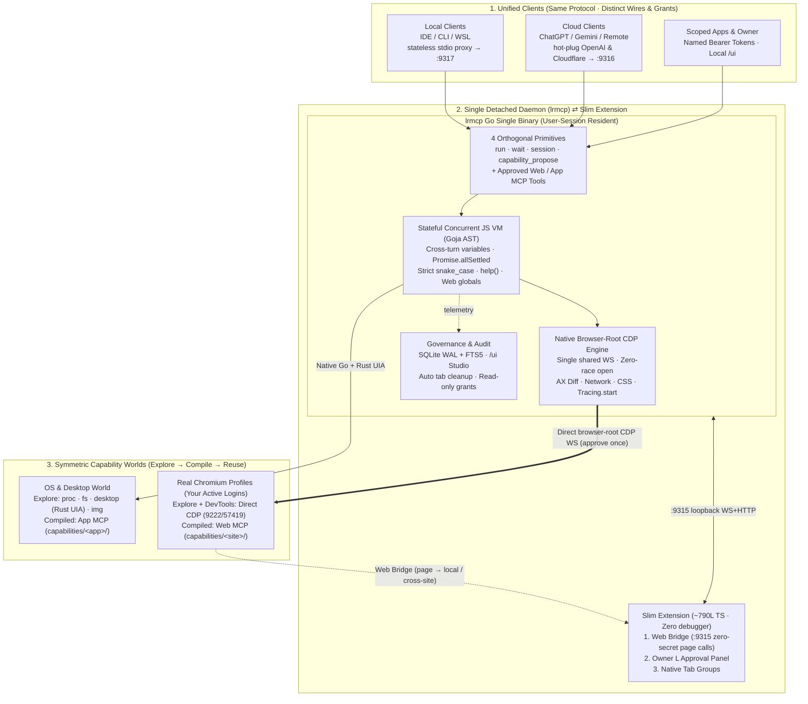

<div align="center">

# Local Runtime MCP (`lrmcp`)

**One single-binary daemon for local & cloud MCP clients — stateful concurrent JS orchestration, native browser-level Chrome DevTools (CDP + `Tracing.start`), atomic OS control, and Windows UI Automation through 4 orthogonal primitives.**

[](https://github.com/hicancan/local-runtime-mcp/releases/latest)
[](https://github.com/hicancan/local-runtime-mcp/actions/workflows/ci.yml)
[](LICENSE)
[](go.mod)
[](native/computer-windows)
[](#installation)

**English** · [简体中文](README.zh-CN.md)

[Why `lrmcp`](#why-lrmcp) · [Architecture](#architecture) · [4 Primitives](#the-4-orthogonal-primitives) · [Quick Start](#quick-start) · [Remote Tunnels](#remote-tunnels--oauth) · [Web & App MCP](#web-mcp--app-mcp-compilation) · [Activity Studio](#activity-studio--audit) · [Security](#security-privacy-and-license)

</div>

---

## Why `lrmcp`

Most MCP setups scatter 30+ flat single-step tools across separate per-IDE Node/Python subprocesses: every click, file read, and network check costs an LLM round-trip, dumps megabytes of raw DOM into context, and re-prompts your browser for remote debugging every time a client restarts.

`lrmcp` collapses the entire stack into **one portable, zero-dependency Go binary** (`~33 MB`, embedded Rust Windows UIA worker + SQLite WAL/FTS5 audit engine + local Activity Studio) and **4 orthogonal primitives**:

| Capability | Traditional Flat MCP / `chrome-devtools-mcp` | `lrmcp` (v18) |
| --- | --- | --- |
| **Tool surface** | 25–40 flat tools; large schemas & serial round-trips | **4 orthogonal primitives** (`run`, `wait`, `session`, `capability_propose`) + owner-approved site/app protocols |
| **Concurrency & state** | 1 step per turn; intermediate data bloats LLM context | **Persistent per-session JS VM** (`Promise.allSettled`, AST top-level persistence, REPL auto-return) — filter in memory, return only answers |
| **Browser & DevTools** | Per-client `npx`/Node subprocess; re-prompts on reconnect; extension `chrome.debugger` banner conflicts | **One shared browser-root CDP WebSocket** (`DevToolsActivePort`): approve once, share across every local & cloud client. Full DevTools + **browser-process `Tracing.start`** + Web Performance API + **-77.8% AX incremental diff** |
| **Companion extension** | Heavy debugger scheduler | **Slim zero-`debugger` extension (~790L TS)** strictly for Web Bridge, owner `L` approval panel, and native `tabGroups` |
| **OS + Desktop + Cloud** | Browser-only, local stdio only | Native `proc` (pipe/PTY), SHA-256 atomic `fs`, `img`, Rust Windows WGC + UIA `desktop`, plus hot-plug **OpenAI & Cloudflare Tunnels** |
| **Governance & telemetry** | No cross-client audit; orphan browser tabs | Embedded **SQLite WAL + FTS5 audit**, local `/ui` Activity Studio, `session(done)` auto-closes temp tabs, **zero external telemetry** |

---

## Architecture

One detached user-session daemon owns the OS runtime (`127.0.0.1:9317`), the native browser-level CDP connections (`Edge`/`Chrome` `DevToolsActivePort`), the loopback extension bridge (`127.0.0.1:9315`), and hot-pluggable remote wires (`127.0.0.1:9316`). Closing any IDE never drops the daemon or your browser session.



---

## The 4 Orthogonal Primitives

| Primitive | Purpose |
| --- | --- |
| **`run(title, code, done_title?, yield_ms?, max_output_bytes?)`** | Execute async JavaScript in this session's persistent VM with full concurrent access to `proc`, `fs`, `browser`, `desktop`, `img`, `caps`, `emitImage`, `print`, `sleep`, `help()`, and Web globals (`URL`, `URLSearchParams`, `atob`, `btoa`, `setTimeout`, embedded-`tzdata` `Intl.DateTimeFormat` & `Date.toLocale*String`). Top-level `let`/`const`/`var`/`function`/`class` persist across turns; bare final expressions auto-return in `cell.value`. |
| **`wait(cell_id, yield_ms?, terminate?)`** | Collect incremental output/images or cancel any long-running cell cleanly. |
| **`session(action='start'\|'update'\|'done', ...)`** | Optional for single-shot read-only queries (call `run` directly). For multi-step or browser tasks, opens a named thread in `/ui` and automatically reclaims temporary browser tabs on `done` (unless marked via `tab.markHandoff()`). |
| **`capability_propose(name, definition, script)`** | Distill a repeatable website workflow explored via `run` into a deterministic Web MCP tool proposal for owner review in the extension's `L` panel. |

### One Turn, Multi-Domain Concurrency

```js
// Executed inside a single `run` call — zero extra LLM round-trips:
const [tab, cfg, ver] = await Promise.all([
  browser.open("https://example.com", { active: false }),
  fs.read("D:\\Dev\\local-runtime-mcp\\config.example.yaml", { start_line: 1, end_line: 25 }),
  proc.run("lrmcp", ["version"]),
]);

const [snap, css, reqs] = await Promise.all([
  tab.snapshot({ diff: true }),                                  // incremental AX diff
  tab.css("a"),                                                  // auto DOM init + computed & matched rules
  tab.network({ resource_types: ["document", "fetch", "xhr"] }), // main Document captured from byte 0
]);

// Bare final expression auto-returns directly in cell.value:
({
  title: tab.title,
  version: ver.stdout.trim(),
  configLines: cfg.end_line,
  docStatus: reqs[0]?.status,
  linkColor: css.computed.color,
  axLines: snap.text.split("\n").length,
})
```

<details>
<summary><strong>Full Built-in JS SDK Reference (also available live inside <code>run</code> via <code>help(topic?)</code>)</strong></summary>

All SDK options use strict `snake_case` with `DisallowUnknownFields` — mismatches fail fast with the exact signature and are recorded in `sub_ops` and `sub_op_errors`.

- **`proc`** — Native OS processes & PTYs (bypassing shell escaping when passing `(program, args)`):
  - `proc.run(program, args?, { cwd?, env?, stdin?, keep_stdin_open?, timeout_seconds?, max_output_bytes?, max_output_tokens?, yield_time_ms?, io_mode?: "pipe"|"pty", columns?, rows? })`
  - `proc.run({ cmd, shell?: "pwsh"|"cmd"|"bash"|"sh", cwd?, env?, ... })`
  - `proc.continue({ session_id, output_cursor?, stdin?, close_stdin?, terminate?, yield_time_ms? })` · `proc.kill(session_id)`
- **`fs`** — Path-locked atomic filesystem with optimistic SHA-256 concurrency control:
  - `fs.list(path, { max_depth?, include_hidden?, max_entries? }?)`
  - `fs.stat(path, { with_sha256? }?)`
  - `fs.read(path, { start_line?, end_line?, line_count?, max_bytes?, with_sha256? }?)` (1-based inclusive)
  - `fs.write(path, content, { mode?: "create"|"replace", expected_sha256?, create_parents? }?)`
  - `fs.patch(path, [{ before?, old, new, after? }], expected_sha256)`
  - `fs.search(path, query, { regex?, case_sensitive?, include_hidden?, max_results? }?)`
- **`browser` & `TabHandle`** — Native browser-level CDP (auto-discovers Edge/Chrome `DevToolsActivePort`):
  - `browser.status()` · `browser.connect(browser_id?)` · `browser.tabs(browser_id? | { browser_id?, include_workers? }?)`
  - `browser.open(url, { browser_id?, active?, session_name? }?)` (creates `about:blank` → attaches & enables domains → `Page.navigate` → awaits load)
  - `browser.tab(id)` · `browser.cdp(method, params?, browser_id?)` · `browser.cleanup()`
  - `browser.traceStart({ browser_id?, tab_id?, reload?, ignore_cache?, categories? }?)` · `browser.traceStop(file_path?, browser_id?)` (streams lossless raw trace via `IO.read` + reads exact kernel Web Performance API metrics: `ttfb_ms`, `fcp_ms`, `lcp_ms`, `dcl_ms`, `load_ms`, `cls`)
  - `tab.goto(url)` · `reload()` · `back()` · `forward()` · `close()` · `markHandoff()`
  - `tab.snapshot({ diff?: true, max_elements?, max_text? }?)` · `tab.screenshot({ full_page?, clip_x?, clip_y?, clip_width?, clip_height? }?)` · `tab.eval(jsOrFn, ...args)` · `tab.cdp(method, params?)`
  - Semantic locators with auto-wait: `tab.getByRole(role, nameOrOpts?)` · `getByText` · `getByLabel` · `getByPlaceholder` · `locator(css)` → `.click()` / `.doubleClick()` / `.hover()` / `.fill(t)` / `.type(t)` / `.press(k)` / `.select(o)` / `.check(b)` / `.uploadFiles(paths)` / `.waitFor({ timeout_ms? })` / `.nth(i)`
  - DevTools: `tab.network({ resource_types?, url_contains?, include_preserved?, failed_only?, limit? }?)` · `tab.networkBody(request_id)` · `tab.console({ levels?, limit? }?)` · `tab.emulate({ width?, height?, mobile?, cpu_throttling_rate?, network_preset?, color_scheme?, reduced_motion?, forced_colors?, user_agent?, geolocation?, extra_headers? })` · `tab.css(selectorOrLoc)` · `tab.heapSnapshot(file_path?)` · `tab.logpoint(url, line, expr, col?)` · `tab.screencastStart(opts?)` · `tab.screencastStop()`
- **`desktop`** — Embedded Rust Windows Graphics Capture (even for covered windows) + UI Automation (zero focus stealing for observation/semantic actions; physical input borrows a revocable token with a clickable bottom-of-screen Stop pill):
  - `desktop.targets({ pid?, title?, process? }?)` · `desktop.state(opts?)` · `desktop.wait(opts)` · `desktop.action(act)` · `desktop.control("status"|"acquire"|"release", opts?)`
- **`img` & `emitImage`** — `img.read(path, { max_bytes?, max_pixels?, crop_x?, crop_y?, crop_width?, crop_height?, max_width?, max_height? }?)` · `emitImage(imgOrShotOrPath, label?)` returns native MCP `ImageContent`.
- **`caps` & Web Globals** — `caps.list()` · `caps.call(name, args?, browser_id?, tab_id?)` · `print(...)` · `sleep(ms)` · `setTimeout` / `clearTimeout` · `URL` / `URLSearchParams` · `atob` / `btoa` · `Intl.DateTimeFormat` / `Date.toLocale*String` (embedded IANA `tzdata`) · `help(topic?)`.

</details>

---

## Quick Start

### 1. Install & Initialize

Download the release archive from [Releases](https://github.com/hicancan/local-runtime-mcp/releases/latest) (or [build from source](#build-and-test)) into its own portable folder:

```powershell
# 1. Initialize local plane (127.0.0.1:9317) so all clients share one detached daemon
./lrmcp.exe setup local

# 2. Initialize slim browser extension (127.0.0.1:9315) for Web Bridge, L panel & Tab Groups
./lrmcp.exe setup browser
```

### 2. Enable Native Browser Debugging (Once per Browser)

- Open `edge://inspect` (Edge) or `chrome://inspect/#remote-debugging` (Chrome) and toggle **Remote debugging** on.
- Load the extracted `browser-extension` directory unpacked in `edge://extensions` / `chrome://extensions` (no `"debugger"` permission required).
- On the first CDP connection, click **Allow** once in your browser's native confirmation dialog. Every local and cloud client attached to `lrmcp` reuses that single authenticated WebSocket until the browser or daemon restarts.

### 3. Connect Any Local MCP Client

```json
{
  "mcpServers": {
    "lrmcp": {
      "command": "D:\\Dev\\local-runtime-mcp\\lrmcp.exe",
      "args": ["serve", "--transport", "stdio", "--agent", "my-client"]
    }
  }
}
```

The first `stdio` client automatically spawns the detached daemon if not yet running and attaches as a thin proxy.

---

## Remote Tunnels & OAuth

Plug and unplug remote wires onto the live daemon with **zero restarts** and **zero disruption** to local clients or active browser sessions:

```powershell
# Hot-plug OpenAI Secure MCP Tunnel (optional auto-expiry lease)
./lrmcp.exe tunnel up openai --ttl 2h

# Hot-plug Cloudflare Tunnel + public loopback HTTP (127.0.0.1:9316)
./lrmcp.exe tunnel up cloudflare

# Restrict any remote wire to strict read-only (enforced inside JS SDK) live
./lrmcp.exe grant remote openai --read-only

# Unplug one or all remote wires (external attack surface drops to 0)
./lrmcp.exe tunnel down all
```

<details>
<summary><strong>OAuth, Named Remote Tokens & Configuration Reference</strong></summary>

Copy `config.example.yaml` to `local-runtime-mcp.yaml` beside `lrmcp` (precedence: **CLI flags > `LOCAL_RUNTIME_MCP_*` env > YAML > defaults**):

```powershell
# Register an OAuth client (e.g. Gemini / ChatGPT connector) with exact redirect URI
./lrmcp.exe setup oauth --client-name gemini --redirect-uri "https://<callback-host>/<path>"
./lrmcp.exe setup oauth --client-name gemini --show

# Mint an independent named Bearer token (coexists with OAuth on :9316)
./lrmcp.exe setup remote-token --id worker-1 --read-only

# Register a scoped local native app token
./lrmcp.exe setup client --id my-app
```

| Environment Variable | YAML Field |
| --- | --- |
| `LOCAL_RUNTIME_MCP_LOCAL_LISTEN` / `_LOCAL_TOKEN` | `local.listen` / `local.token` |
| `LOCAL_RUNTIME_MCP_BROWSER_LISTEN` / `_BROWSER_TOKEN` | `browser.listen` / `browser.token` |
| `LOCAL_RUNTIME_MCP_OPENAI_TUNNEL_ID` / `_API_KEY` | `openai.tunnel_id` / `openai.api_key` |
| `LOCAL_RUNTIME_MCP_HTTP_LISTEN` / `_PUBLIC_HOST` / `_AUTH` / `_BEARER_TOKEN` | `http.*` |
| `LOCAL_RUNTIME_MCP_OAUTH_OWNER_TOKEN` | `http.oauth.owner_token` |
| `LOCAL_RUNTIME_MCP_CLOUDFLARE_TUNNEL_TOKEN` / `_CLOUDFLARED` | `cloudflare.tunnel_token` / `cloudflare.binary` |
| `LOCAL_RUNTIME_MCP_CLIENT_TOKEN_<ID>` / `_REMOTE_TOKEN_<ID>` | `grants.clients` / `grants.remote.tokens` |

See [docs/connections.md](docs/connections.md) for step-by-step OpenAI, Cloudflare, and OAuth walkthroughs.

</details>

---

## Web MCP & App MCP Compilation

`lrmcp` turns expensive exploratory browsing into versioned, deterministic site and app protocols:

1. **Explore** any website using `run` (`tab.snapshot`, `tab.network`, `tab.eval`).
2. **Propose** a reusable typed function via `capability_propose(name, definition, script)`.
3. **Approve** the exact JavaScript in the browser extension's **`L` panel** — it persists under `capabilities/<site>/` (Web MCP) or `capabilities/<app>/` (App MCP), hot-reloads immediately, executes over native CDP with strict origin & JSON-Schema verification, and can be consumed both by MCP clients (`caps.call(...)` or direct tool call) and by owner-authorized web pages via the zero-secret **Web Bridge** (`:9315`).

---

## Activity Studio & Audit

Every call is recorded into an embedded pure-Go **SQLite WAL + FTS5** database (`lrmcp-audit.db`) with dual-state `title` → `done_title` summaries, per-operation `sub_ops` timings/errors, and automatic 15-minute idle session decay.

```powershell
# Open local-only Activity Studio (http://127.0.0.1:9317/ui/)
./lrmcp.exe ui

# Three-layer CLI drill-down
./lrmcp.exe audit list --limit 10
./lrmcp.exe audit events --session <ID> --compact
./lrmcp.exe audit show <EVENT_ID>
./lrmcp.exe audit search "example.com" --compact
./lrmcp.exe audit tail
```

---

## Installation & Build

| Platform | Process, Filesystem, Image | Browser CDP + DevTools | Desktop UIA |
| --- | --- | --- | --- |
| **Windows amd64** | Full | Chromium 120+ (`DevToolsActivePort`) + Slim Extension | Embedded Rust WGC + UIA |
| **Linux amd64 / arm64** | Full | Chromium 120+ (`DevToolsActivePort`) + Slim Extension | Reports platform unavailability |

<details>
<summary><strong>Build & Test From Source (Go 1.27 · Node.js 24 · Rust 1.96)</strong></summary>

```powershell
# 1. Build & test slim browser extension (also syncs internal/version/version.go)
Push-Location browser-extension
npm ci && npm run build && npm test
Pop-Location

# 2. (Windows, optional if native worker unchanged) Build embedded Rust UIA worker
./scripts/build-native.ps1

# 3. Test & build single portable binary
go test -count=1 ./...
go vet ./...
go build -trimpath -ldflags="-s -w" -o lrmcp.exe ./cmd/lrmcp
```

</details>

---

## Security, Privacy, and License

- Authenticated clients operate under the OS account running `lrmcp`; `127.0.0.1:9317` (local plane) and `127.0.0.1:9315` (extension bridge) strictly reject non-loopback hosts, foreign origins, and proxy headers.
- Remote wires obey per-wire `grants.remote` boundaries (including SDK-enforced read-only mode), and OAuth grant persistence stores SHA-256 digests only (`lrmcp-oauth-grants.json`, zero plaintext tokens on disk).
- **Zero telemetry or phone-home** — everything stays on your machine unless you explicitly plug in a tunnel.
- See [SECURITY.md](SECURITY.md), [PRIVACY.md](PRIVACY.md), and [THIRD_PARTY_NOTICES.md](THIRD_PARTY_NOTICES.md).
- Licensed under [GNU AGPL v3.0 only](LICENSE).
