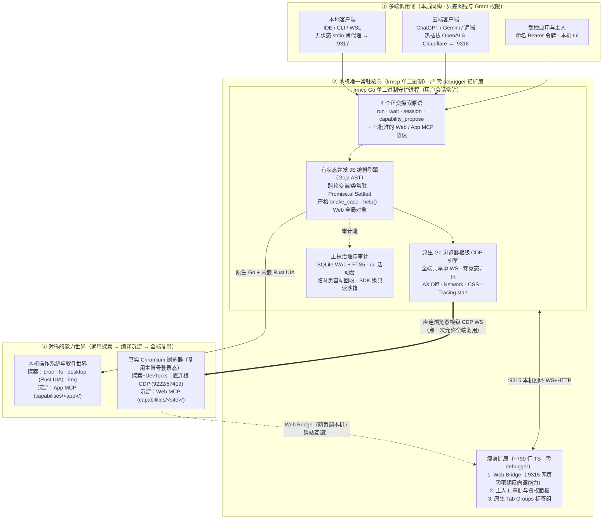

<div align="center">

# Local Runtime MCP (`lrmcp`)

**一枚单文件常驻守护进程，让本地与云端 MCP 客户端通过 4 个正交原语和有状态并发 JS 编排引擎，统一掌控你的本机进程、原子文件、完整 Chrome DevTools（原生根级 CDP + 进程级 `Tracing.start`）与 Windows 原生桌面。**

[](https://github.com/hicancan/local-runtime-mcp/releases/latest)
[](https://github.com/hicancan/local-runtime-mcp/actions/workflows/ci.yml)
[](LICENSE)
[](go.mod)
[](native/computer-windows)
[](#安装与构建)

[English](README.md) · **简体中文**

[为什么选 `lrmcp`](#为什么选-lrmcp) · [大一统架构](#大一统架构) · [4 个正交原语](#4-个正交原语) · [快速上手](#快速上手) · [远程隧道与 OAuth](#远程隧道与-oauth) · [Web & App MCP 沉淀](#web-mcp--app-mcp-正向沉淀) · [活动台与审计](#活动台与审计) · [安全与许可](#安全隐私与许可)

</div>

---

## 为什么选 `lrmcp`

传统 MCP 方案把几十个扁平单步工具塞进各自独立的 Node/Python 子进程：每读一个文件、点一次按钮、查一条网络请求都要往返大模型一轮，把几十 KB 原始 DOM 和 JSON 倒进上下文；每换一个 IDE 或重启会话，Edge/Chrome 还得反复弹一次远程调试授权框。

`lrmcp` 把整套能力收敛进**一枚 ~33 MB、零外部运行时依赖的 Go 单二进制守护进程**（内嵌 Rust Windows UIA 引擎 + SQLite WAL/FTS5 审计库 + 本地活动台 `/ui`），对外仅暴露 **4 个正交原语**：

| 维度 | 传统扁平 MCP / `chrome-devtools-mcp` | `lrmcp`（v18） |
| --- | --- | --- |
| **工具门面** | 25–40 个零散工具，Schema 臃肿、单步串行往返 | **4 个正交原语**（`run`、`wait`、`session`、`capability_propose`）+ 主人审批的站点/软件协议 |
| **并发与状态** | 每步来回刷大模型，中间数据撑爆上下文 | **按会话常驻的并发 JS 引擎**（`Promise.allSettled`、AST 跨轮持久化、裸表达式回显）——内存内过滤，只吐精炼结果 |
| **浏览器与 DevTools** | 每端独立 `npx`/Node 进程，换端反复弹窗；扩展 `chrome.debugger` 弹横幅冲突 | **全机唯一浏览器根级 CDP 长连接**（`DevToolsActivePort`）：点一次允许，全端共享免打扰。完整 DevTools + **进程级 `Tracing.start`** + 内核 Performance API + **AX 增量 Diff（体积 -77.8%）** |
| **配套浏览器扩展** | 沉重的 `debugger` 调度器 | **瘦身零 `debugger` 扩展（~790 行 TS）**，仅管 Web Bridge 网页互联、主人 `L` 审批面板与原生 `tabGroups` |
| **跨域协同与云端** | 仅限本地浏览器，各工具割裂 | 原生 `proc`（pipe/PTY）、SHA-256 原子 `fs`、`img`、Rust Windows WGC/UIA 桌面控制，外加热插拔 **OpenAI & Cloudflare 隧道** |
| **治理与隐私** | 无跨端任务审计、常留僵尸标签页 | 嵌入式 **SQLite WAL + FTS5 审计**、本机 `/ui` 活动台、`session(done)` 自动回收临时页、**零外部遥测** |

---

## 大一统架构

全机只运行一个独立的用户会话守护进程，统一托管本机总线（`127.0.0.1:9317`）、原生浏览器根级 CDP 长连（Edge/Chrome `DevToolsActivePort`）、回环轻扩展桥（`127.0.0.1:9315`）与热插拔公网面（`127.0.0.1:9316`）。关闭任何 IDE 或 CLI 都不会让守护进程或浏览器长连接掉线。



---

## 4 个正交原语

| 原语 | 职责 |
| --- | --- |
| **`run(title, code, done_title?, yield_ms?, max_output_bytes?)`** | 在当前会话的持久 JS 虚拟机里并发调度 `proc`、`fs`、`browser`、`desktop`、`img`、`caps`、`emitImage`、`print`、`sleep`、`help()` 以及标准 Web 全局对象（`URL`、`URLSearchParams`、`atob`、`btoa`、`setTimeout`）。顶层 `let`/`const`/`var`/`function`/`class` 跨轮保留；末尾裸表达式自动回显在 `cell.value`。 |
| **`wait(cell_id, yield_ms?, terminate?)`** | 续接耗时较长的执行单元、收集增量输出与图片，或随时一键终止。 |
| **`session(action='start'\|'update'\|'done', ...)`** | 单次只读查询可直接调用 `run` 免开闭会话；多步任务或打开浏览器标签页时用 `start` 建立命名任务线，`done` 时自动关闭未移交用户的临时标签页并明确回传 `closed_tabs`。 |
| **`capability_propose(name, definition, script)`** | 模型探索完某个网站后，把可复用步骤写成确定性脚本提交提案，经主人在扩展 `L` 面板审代码批准后正式生效。 |

### 一轮调用，多域真并发示例

```js
// 在一次 `run` 内并发完成网页开页、本地配置按行读取、命令执行与全套只读检查：
const [tab, cfg, ver] = await Promise.all([
  browser.open("https://example.com", { active: false }),
  fs.read("D:\\Dev\\local-runtime-mcp\\config.example.yaml", { start_line: 1, end_line: 25 }),
  proc.run("lrmcp", ["version"]),
]);

const [snap, css, reqs] = await Promise.all([
  tab.snapshot({ diff: true }),                                  // 增量 AX Diff
  tab.css("a"),                                                  // 自动初始化 DOM + 计算/命中样式
  tab.network({ resource_types: ["document", "fetch", "xhr"] }), // 从第 0 字节捕获主文档
]);

// 末尾裸表达式自动回显到 cell.value，无需手写 print/return：
({
  title: tab.title,
  version: ver.stdout.trim(),
  configLines: cfg.end_line,
  docStatus: reqs[0]?.status,
  linkColor: css.computed.color,
  axLines: snap.text.split("\n").length,
})
```

<details>
<summary><strong>内置 JS SDK 完整速查（在 <code>run</code> 内随时执行 <code>help(topic?)</code> 同样可得）</strong></summary>

所有 SDK 选项严格使用 `snake_case` 并开启 `DisallowUnknownFields`：传错参数立即附带正确签名报错，且无论是否被 `Promise.allSettled` 捕获，都会完整记入 `sub_ops` 与 `sub_op_errors`。

- **`proc`** — 原生进程与交互式 PTY（直接传 `(program, args)` 免去壳层转义）：
  - `proc.run(program, args?, { cwd?, env?, stdin?, keep_stdin_open?, timeout_seconds?, max_output_bytes?, max_output_tokens?, yield_time_ms?, io_mode?: "pipe"|"pty", columns?, rows? })`
  - `proc.run({ cmd, shell?: "pwsh"|"cmd"|"bash"|"sh", cwd?, env?, ... })`
  - `proc.continue({ session_id, output_cursor?, stdin?, close_stdin?, terminate?, yield_time_ms? })` · `proc.kill(session_id)`
- **`fs`** — 路径锁 + SHA-256 乐观锁原子文件系统：
  - `fs.list(path, { max_depth?, include_hidden?, max_entries? }?)`
  - `fs.stat(path, { with_sha256? }?)`
  - `fs.read(path, { start_line?, end_line?, line_count?, max_bytes?, with_sha256? }?)`（1-based 闭区间）
  - `fs.write(path, content, { mode?: "create"|"replace", expected_sha256?, create_parents? }?)`
  - `fs.patch(path, [{ before?, old, new, after? }], expected_sha256)`
  - `fs.search(path, query, { regex?, case_sensitive?, include_hidden?, max_results? }?)`
- **`browser` 与 `TabHandle`** — 原生浏览器根级 CDP（自动发现 Edge/Chrome `DevToolsActivePort`）：
  - `browser.status()` · `browser.connect(browser_id?)` · `browser.tabs(browser_id? | { browser_id?, include_workers? }?)`
  - `browser.open(url, { browser_id?, active?, session_name? }?)`（先建 `about:blank` → 附着开全观测域 → `Page.navigate` → 等加载完毕，零竞态不漏主文档）
  - `browser.tab(id)` · `browser.cdp(method, params?, browser_id?)` · `browser.cleanup()`
  - `browser.traceStart({ browser_id?, tab_id?, reload?, ignore_cache?, categories? }?)` · `browser.traceStop(file_path?, browser_id?)`（`IO.read` 无损落盘原始轨迹 + 直接读取浏览器内核 Web Performance API：`ttfb_ms`、`fcp_ms`、`lcp_ms`、`dcl_ms`、`load_ms`、`cls`）
  - `tab.goto(url)` · `reload()` · `back()` · `forward()` · `close()` · `markHandoff()`
  - `tab.snapshot({ diff?: true, max_elements?, max_text? }?)` · `tab.screenshot({ full_page?, clip_x?, clip_y?, clip_width?, clip_height? }?)` · `tab.eval(js)` · `tab.cdp(method, params?)`
  - 带自动等待的语义定位器：`tab.getByRole(role, nameOrOpts?)` · `getByText` · `getByLabel` · `getByPlaceholder` · `locator(css)` → `.click()` / `.doubleClick()` / `.hover()` / `.fill(t)` / `.type(t)` / `.press(k)` / `.select(o)` / `.check(b)` / `.uploadFiles(paths)` / `.waitFor({ timeout_ms? })` / `.nth(i)`
  - 全套 DevTools：`tab.network({ resource_types?, url_contains?, include_preserved?, failed_only?, limit? }?)` · `tab.networkBody(request_id)` · `tab.console({ levels?, limit? }?)` · `tab.emulate({ width?, height?, mobile?, cpu_throttling_rate?, network_preset?, color_scheme?, reduced_motion?, forced_colors?, user_agent?, geolocation?, extra_headers? })` · `tab.css(selectorOrLoc)` · `tab.heapSnapshot(file_path?)` · `tab.logpoint(url, line, expr, col?)` · `tab.screencastStart(opts?)` · `tab.screencastStop()`
- **`desktop`** — 内嵌 Rust Windows Graphics Capture（窗口被遮挡也能清晰抓帧）+ UI Automation（观察和语义控件操作绝不抢焦点；仅物理键鼠需借用独占令牌，屏幕底部带可随时点停的提示条）：
  - `desktop.targets({ pid?, title?, process? }?)` · `desktop.state(opts?)` · `desktop.wait(opts)` · `desktop.action(act)` · `desktop.control("status"|"acquire"|"release", opts?)`
- **`img` 与 `emitImage`** — `img.read(path, { max_bytes?, max_pixels?, crop_x?, crop_y?, crop_width?, crop_height?, max_width?, max_height? }?)` · `emitImage(imgOrShotOrPath, label?)` 直接回传原生 MCP 多模态图片。
- **`caps` 与标准全局对象** — `caps.list()` · `caps.call(name, args?, browser_id?, tab_id?)` · `print(...)` · `sleep(ms)` · `setTimeout` / `clearTimeout` · `URL` / `URLSearchParams` · `atob` / `btoa` · `help(topic?)`。

</details>

---

## 快速上手

### 1. 下载与初始化

从 [Releases](https://github.com/hicancan/local-runtime-mcp/releases/latest) 下载对应平台压缩包（或[从源码构建](#安装与构建)），解压到独立便携目录：

```powershell
# 1. 初始化本机面（127.0.0.1:9317），让所有客户端共享同一常驻守护进程
./lrmcp.exe setup local

# 2. 初始化瘦身扩展桥（127.0.0.1:9315），用于 Web Bridge、L 面板与标签分组
./lrmcp.exe setup browser
```

### 2. 开启浏览器原生远程调试（每个浏览器只需一次）

- 打开 `edge://inspect`（Edge）或 `chrome://inspect/#remote-debugging`（Chrome）打开 **远程调试** 开关。
- 在 `edge://extensions` / `chrome://extensions` 开启开发者模式，加载解压出来的 `browser-extension` 目录（无需 `"debugger"` 权限）。
- 首次发起 CDP 连接时，在浏览器弹出的原生确认框点一次 **允许**。只要浏览器与守护进程未重启，此后所有本地与云端客户端均复用这一根长连接，不再反复弹窗。

### 3. 接入任意本地 MCP 客户端

```json
{
  "mcpServers": {
    "lrmcp": {
      "command": "D:\\Dev\\local-runtime-mcp\\lrmcp.exe",
      "args": ["serve", "--transport", "stdio", "--agent", "my-client"]
    }
  }
}
```

首个接入的 `stdio` 客户端会在守护进程未运行时自动拉起独立后台进程，自身仅作无状态薄代理。

---

## 远程隧道与 OAuth

在运行中的守护进程上**零重启热插拔**公网外线，插拔过程完全不打断本地客户端或浏览器长连接：

```powershell
# 热插 OpenAI Secure MCP Tunnel（支持到期自动断开租约）
./lrmcp.exe tunnel up openai --ttl 2h

# 热插 Cloudflare Tunnel + 公网回环 HTTP（127.0.0.1:9316）
./lrmcp.exe tunnel up cloudflare

# 实时将任意外线收紧为严格只读（在 JS SDK 层硬拦截写与进程执行）
./lrmcp.exe grant remote openai --read-only

# 拔掉单条或全部外线（拔除后外网暴露面严格为 0）
./lrmcp.exe tunnel down all
```

<details>
<summary><strong>OAuth、命名远端令牌与环境变量配置</strong></summary>

复制 `config.example.yaml` 为同目录 `local-runtime-mcp.yaml`（优先级：**命令行参数 > `LOCAL_RUNTIME_MCP_*` 环境变量 > YAML > 默认值**）：

```powershell
# 注册 OAuth 客户端（如 Gemini / ChatGPT 连接器）并绑定精确回调地址
./lrmcp.exe setup oauth --client-name gemini --redirect-uri "https://<callback-host>/<path>"
./lrmcp.exe setup oauth --client-name gemini --show

# 签发独立命名的 Bearer 令牌（与 OAuth 在 :9316 共存）
./lrmcp.exe setup remote-token --id worker-1 --read-only

# 注册本机受控应用令牌
./lrmcp.exe setup client --id my-app
```

| 环境变量 | 对应 YAML 字段 |
| --- | --- |
| `LOCAL_RUNTIME_MCP_LOCAL_LISTEN` / `_LOCAL_TOKEN` | `local.listen` / `local.token` |
| `LOCAL_RUNTIME_MCP_BROWSER_LISTEN` / `_BROWSER_TOKEN` | `browser.listen` / `browser.token` |
| `LOCAL_RUNTIME_MCP_OPENAI_TUNNEL_ID` / `_API_KEY` | `openai.tunnel_id` / `openai.api_key` |
| `LOCAL_RUNTIME_MCP_HTTP_LISTEN` / `_PUBLIC_HOST` / `_AUTH` / `_BEARER_TOKEN` | `http.*` |
| `LOCAL_RUNTIME_MCP_OAUTH_OWNER_TOKEN` | `http.oauth.owner_token` |
| `LOCAL_RUNTIME_MCP_CLOUDFLARE_TUNNEL_TOKEN` / `_CLOUDFLARED` | `cloudflare.tunnel_token` / `cloudflare.binary` |
| `LOCAL_RUNTIME_MCP_CLIENT_TOKEN_<ID>` / `_REMOTE_TOKEN_<ID>` | `grants.clients` / `grants.remote.tokens` |

完整接入步骤见 [docs/connections.md](docs/connections.md)。

</details>

---

## Web MCP & App MCP 正向沉淀

`lrmcp` 把高成本、不稳定的网页摸索持续“编译”成可版本化迭代的确定性站点与软件协议：

1. **探索**：先用 `run`（`tab.snapshot`、`tab.network`、`tab.eval`）摸清陌生网站或桌面软件。
2. **提案**：通过 `capability_propose(name, definition, script)` 提交带精确域名与输入/输出 JSON Schema 的确定性脚本。
3. **审批与复用**：主人在扩展 **`L` 面板** 审完代码点批准，即刻落盘至 `capabilities/<site>/`（Web MCP）或 `capabilities/<app>/`（App MCP）并热重载——底层直接走 Go 原生 CDP 执行并校验来源与 Schema，同时供所有 MCP 客户端（直接调用或在 `run` 内经 `caps.call(...)` 并发混编）与获得主人授权的网页（经 `:9315` **Web Bridge** 零密钥调用）共同复用。

---

## 活动台与审计

每一次调用都按任务线沉淀进纯 Go 嵌入式 **SQLite WAL + FTS5** 审计库（`lrmcp-audit.db`），支持 `title` → `done_title` 双态摘要翻转、细粒度 `sub_ops` 耗时与错参追踪，以及空置 15 分钟自动衰减为 `idle`。

```powershell
# 打开仅本机可访问的活动台（http://127.0.0.1:9317/ui/）
./lrmcp.exe ui

# CLI 三层钻取排查
./lrmcp.exe audit list --limit 10
./lrmcp.exe audit events --session <ID> --compact
./lrmcp.exe audit show <EVENT_ID>
./lrmcp.exe audit search "example.com" --compact
./lrmcp.exe audit tail
```

---

## 安装与构建

| 平台 | 进程、文件、图片 | 浏览器原生 CDP + DevTools | 桌面 UIA 控制 |
| --- | --- | --- | --- |
| **Windows amd64** | 完整支持 | Chromium 120+（`DevToolsActivePort`）+ 瘦身扩展 | 内嵌 Rust WGC + UIA |
| **Linux amd64 / arm64** | 完整支持 | Chromium 120+（`DevToolsActivePort`）+ 瘦身扩展 | 明确返回平台不可用 |

<details>
<summary><strong>从源码构建与测试（Go 1.27 · Node.js 24 · Rust 1.96）</strong></summary>

```powershell
# 1. 构建并测试瘦身浏览器扩展（同步更新 internal/version/version.go）
Push-Location browser-extension
npm ci && npm run build && npm test
Pop-Location

# 2. （Windows，仅在修改 Rust 桌面引擎时需要）构建内嵌工作器
./scripts/build-native.ps1

# 3. 运行全量测试并编译单文件二进制
go test -count=1 ./...
go vet ./...
go build -trimpath -ldflags="-s -w" -o lrmcp.exe ./cmd/lrmcp
```

</details>

---

## 安全、隐私与许可

- 通过认证的客户端以运行 `lrmcp` 的系统账户权限执行；本机面（`127.0.0.1:9317`）与扩展桥（`127.0.0.1:9315`）严格拒绝非回环主机、跨源请求与代理头。
- 远端外线严格遵循 `grants.remote` 权限边界（含 SDK 级只读沙箱），OAuth 访问与刷新令牌仅驻留内存、重启即清空。
- **零遥测、零静默上报**——除你主动插上的隧道之外，一切数据留在本地。
- 详见 [SECURITY.md](SECURITY.md)、[PRIVACY.md](PRIVACY.md) 与 [THIRD_PARTY_NOTICES.md](THIRD_PARTY_NOTICES.md)。
- 遵循 [GNU AGPL v3.0 only](LICENSE) 开源许可。
