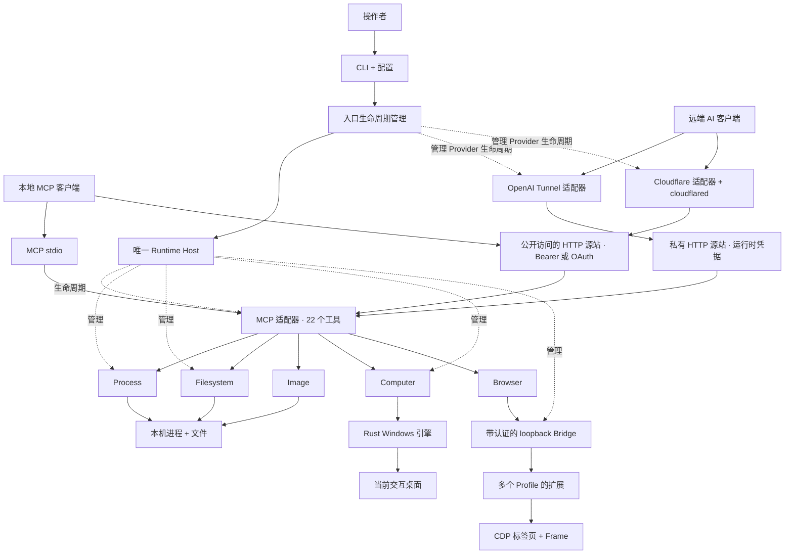
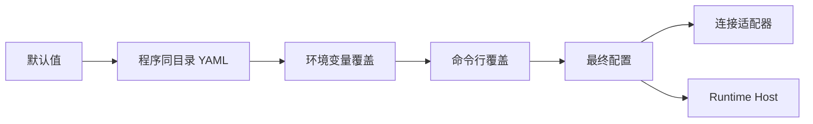
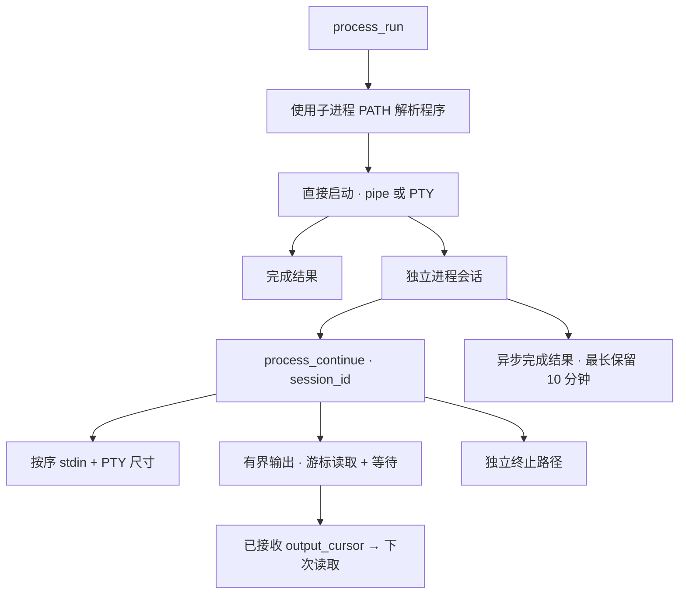
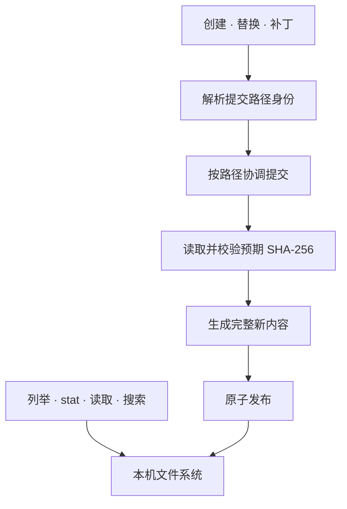
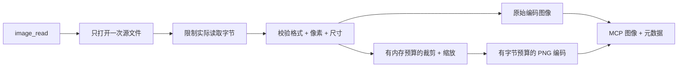
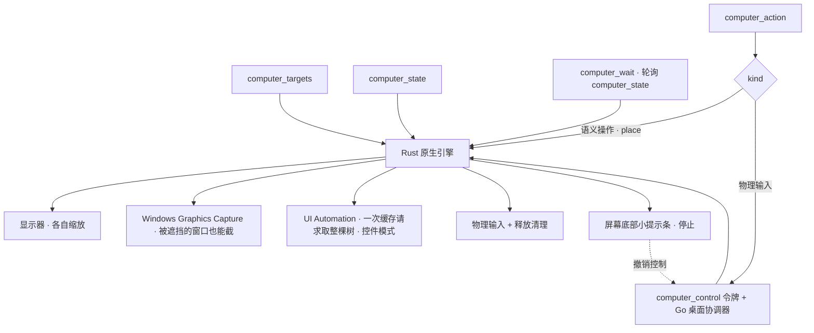
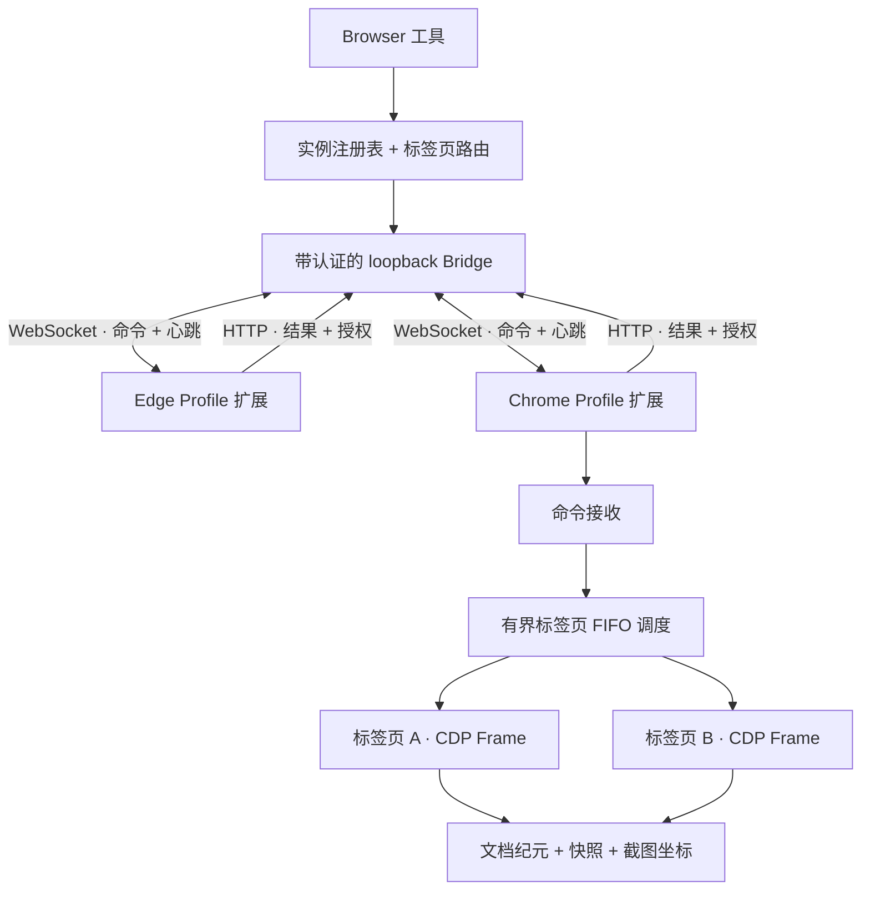

# Local Runtime MCP

[](https://github.com/hicancan/local-runtime-mcp/actions/workflows/ci.yml)
[](https://github.com/hicancan/local-runtime-mcp/releases/latest)
[](LICENSE)
[](https://m8ven.ai/mcp/hicancan/local-runtime-mcp)

[English](README.md) · **简体中文**

让 AI 客户端使用运行 `lrmcp` 的机器上的程序、文件、图像、浏览器配置文件和桌面。Local Runtime MCP 是一个便携的本地运行时，提供 **22 个内建 MCP 工具**，并从文件树注册可复用网页能力。

同一个运行时还提供按网站来源授权的网页 SDK，以及使用独立 Key 的本地模型 API。浏览器里的模型通过 `start / read / stop` 能力成为模型来源，Harness 和 StuDev 保留自己的工具循环。见 [工具、网页与模型](docs/models.zh-CN.md)。

本地客户端可以使用 stdio 或 Streamable HTTP；远端客户端可以通过 OpenAI Secure MCP Tunnel 和 Cloudflare Tunnel 接入。同一个运行实例可以同时开启两条隧道，共享一套进程会话、浏览器实例和桌面控制。不同进程会话和浏览器标签页可以并发执行，共享文件和桌面输入则按照明确的资源规则协调。

- **原生多模态结果**：文件、网页和桌面观察直接返回文本与 MCP 图像内容。
- **明确的浏览器目标**：连接多个 Chromium Profile，选择有名称的浏览器实例，通过不透明标签页句柄操作。
- **不打扰人的桌面控制**：看到所有显示器和窗口，读出带文字的 UI Automation 树，通过控件模式操作控件，不碰鼠标、键盘和焦点。确需物理输入时凭令牌借用，屏幕底部的小提示条随时可点停。
- **便携配置**：将 `local-runtime-mcp.yaml`、程序和浏览器集成保存在同一目录，支持固定磁盘与移动存储。
- **独立连接入口**：为同一个 Runtime Host 启用 OpenAI、Cloudflare 或两者；公开 HTTP 支持静态 Bearer 凭据和经所有者批准的 OAuth 授权。
- **按平台职责实现**：Go 承载运行时和 MCP 适配器，Rust 实现 Windows 捕获、UI Automation 和输入，TypeScript 实现 Chromium 集成。

## 整体架构

连接层负责请求怎样到达，能力层负责机器上执行什么。一个 Runtime Host 管理当前实例中所有已启用入口和客户端共享的资源。



实线表示请求链路，虚线表示资源生命周期归属。文本与图像作为 MCP 内容传输。OpenAI 私有源站和公开访问的 HTTP 源站提供同一个 MCP Server，各自保留对应认证边界。Cloudflare 通过 loopback 访问源站，对外地址使用 HTTPS。

| 层 | 职责 |
| --- | --- |
| CLI 与配置 | 明确选择入口，一次性解析配置。 |
| 入口生命周期管理 | 管理 Provider、报告退出状态，保持其他入口可用。 |
| 连接适配器 | 通过 stdio、HTTP 或 Tunnel Provider 递送请求到共享 Server。 |
| MCP 适配器 | 发布工具 schema、验证参数、编码结果。 |
| 能力服务 | 定义资源身份、观察、操作与并发规则。 |
| 平台后端 | 执行操作系统调用、Windows 原生交互和 Chromium CDP 命令。 |

Host 只创建一套 Process Manager、Filesystem Service、Browser Bridge 和 Computer Controller。Provider 失败只影响对应入口，Host 和其他在线入口继续运行。所有入口结束或操作者中断运行时，停止接收工作，取消待执行请求，清理受管进程与注入输入，关闭连接及配套程序。单次请求失败后，Host 和其他资源继续运行。连接恢复只恢复通信，机器操作由客户端明确发起。

### 命令与传输

```text
lrmcp
├── serve
│   ├── --transport stdio|local|http
│   └── --tunnel openai|cloudflare   （HTTP 下可重复）
├── setup
│   ├── browser
│   ├── local
│   ├── client
│   └── oauth
├── version
└── help
```

`serve` 启动唯一 Host（或在已有本机 Daemon 时让 `stdio` 自动退化为透明薄代理附着复用）。`--transport local` 只启动本机专属面（`127.0.0.1:9317`）与扩展桥（`127.0.0.1:9315`）；`--transport http` 同时开放公网/隧道面（`127.0.0.1:9316`，仅承载远端 `/mcp` 与 OAuth，不暴露 `/v1` 与 `LocalApps`）。

| 命令 | 链路与凭据 |
| --- | --- |
| `lrmcp serve --transport stdio` | 标准 MCP 进程管道；若 `127.0.0.1:9317` 已有 Daemon，则自动作为薄代理附着共享（支持多个 Codex 并发共享与实时 `tools/list_changed`）。 |
| `lrmcp serve --transport local` | 纯本机常驻 Daemon：只监听本机专属面 `127.0.0.1:9317`（`/mcp`、`/v1`、`/capabilities`）与扩展桥 `127.0.0.1:9315`，不开放任何公网端口。 |
| `lrmcp serve --transport http` | 同时启动本机专属面（若已配置）与公网 loopback HTTP（`127.0.0.1:9316/mcp`）。 |
| `lrmcp serve --transport http --tunnel openai` | 官方 OpenAI 转发连接私有 loopback MCP 端点，配置 Tunnel ID 与 API key。 |
| `lrmcp serve --transport http --tunnel cloudflare` | 官方 `cloudflared` 转发到公网 loopback HTTP（`127.0.0.1:9316`）。 |
| `lrmcp serve --transport http --tunnel openai --tunnel cloudflare` | 两种远端 Provider 与全部本机客户端共享同一个 Host 和资源。 |
| `lrmcp setup browser` | 生成 Bridge 凭据，释放和配置扩展。 |
| `lrmcp setup local` | 生成本机专属面 `local.token`，开启多 `stdio` 客户端共享。 |
| `lrmcp setup client --id NAME [--model ID]` | 在 `grants.clients` 中注册同机受控应用并生成独立 Scoped Token（`--show` 查看）。 |
| `lrmcp setup oauth --client-name NAME --redirect-uri URI` | 用准确回调地址注册 OAuth 客户端并生成凭据。 |
| `lrmcp setup oauth --show` | 在本地终端明确查看已有 OAuth 凭据。 |
| `lrmcp version` | 输出可执行文件版本。 |
| `lrmcp help` | 显示命令与参数。 |

OpenAI 适配器使用动态分配的本机端口和运行时生成、保存在内存中的私有链路凭据。Cloudflare 使用配置中的公开访问 loopback 源站及官方维护的配套程序。能力服务独立于 Provider。另一台机器运行自己的 Host 并使用独立连接地址，资源和句柄也属于各自机器。

### 配置



优先级为 **命令行 > 环境变量 > YAML > 默认值**。配置固定读取 `<lrmcp 所在目录>/local-runtime-mcp.yaml`，按本次启用的组件验证配置。浏览器实例身份保存在各 Profile 的扩展存储中；进程、标签页和桌面观察句柄由当前资源生命周期管理。

## 五个能力域

| 领域 | 工具数量 |
| --- | ---: |
| Process | 2 |
| Filesystem | 6 |
| Image | 1 |
| Computer | 5 |
| Browser | 8 |
| **总计** | **22** |

### Process · 2 个工具



- `process_run` 接收程序名、参数数组、工作目录、环境变量覆盖、初始 stdin、执行期限、输出上限和 pipe/PTY I/O 模式。
- `process_continue` 按明确的字节位置读取保留输出、写入 stdin、关闭 pipe 输入、调整 PTY 尺寸、等待或终止受管会话。

pipe 和 PTY 都使用合并后的子进程 `PATH` 查找程序，Windows 还使用 `PATHEXT`。显式相对程序路径以请求的工作目录为基准。需要 shell 语法时，明确启动所需 shell 并传入参数。

不同会话并行运行。同一会话的输入按序写入，读取会保留有界的 stdout 与 stderr 缓冲。等待输出不会阻塞终止路径，stdin 写入堵塞时也能终止。输出和输入等待有容量上限，单次 stdin 最大为 16 MiB。

每次结果都返回 `output_cursor: {stdout, stderr}`，表示两条流下一次读取的字节位置。将上一次成功收到的游标传给 `process_continue`，即可只取得新输出；省略游标则从零开始重读保留内容。返回的 `stdout_offset`、`stderr_offset` 表示实际起点；请求位置早于当前缓冲时，截断标志会明确指出前缀已被淘汰。已完成的异步会话最长保留 10 分钟。容量不足时，最早完成的会话让位给新进程，运行中的会话继续保留。

纯读取的响应丢失后，可用相同的 `session_id` 和游标再次调用 `process_continue`；结果还可能包含重试前新产生的输出。成功收到结果后才推进游标并拼接输出。启动进程、写入 stdin、调整 PTY 尺寸或终止进程的请求，在结果不确定时应先检查资源状态，再决定是否重试。首次启动响应丢失时，客户端可能还没有取得会话 ID。

`duration_ms` 在进程运行期间表示已运行时长，退出后固定为实际进程生命周期。稍后再采集完成结果时，这个时长保持不变。

取消信号到达尚未交付运行中会话的 `process_run` 时，会终止并回收该进程。取消信号到达 `process_continue` 时，只结束本次等待；结束会话使用 `terminate=true`。HTTP 断连的取消传播遵循协商的 MCP 协议：SDK 对 `2026-07-28` 及更新协议传播请求上下文取消，旧版无状态请求可能在客户端断开后继续完成有界等待。进程执行期限与 Host 退出独立于单次 MCP 请求期限。

### Filesystem · 6 个工具



| 工具 | 操作 |
| --- | --- |
| `filesystem_list` | 有界目录遍历。 |
| `filesystem_stat` | 元数据与可选 SHA-256。 |
| `filesystem_read_text` | 按行范围读取 UTF-8，设置行数与字节上限。 |
| `filesystem_search_text` | 字面文本或 Go 正则搜索。 |
| `filesystem_write_text` | 明确选择 `mode=create` 或 `mode=replace`。 |
| `filesystem_patch_text` | 带版本校验、唯一上下文锚点的补丁。 |

`create` 在目标不存在时发布完整文件；`replace` 要求文件已存在，并提供 `expected_sha256`。Patch 同样要求预期 hash，所有 hunk 都基于同一个不可变原始版本定位。

文本读取返回完整行。第一条目标行超过字节预算时返回有界错误；已经读取完整行后遇到超限则报告截断和下一行号。跳过的行使用固定内存扫描，需要 SHA-256 时通过流式读取计算整个文件的 hash。

Filesystem Service 从版本校验到提交全程持有对应路径的锁。不同路径与读操作可并行。修改拒绝最终路径上的符号链接，并规范化已有父目录的别名以协调提交。

这些锁协调本 Host 发出的文件调用。外部编辑器和被启动的程序按各自规则访问文件系统。并发编码任务可以使用不同 Git worktree，分开索引和构建输出。

### Image · 1 个工具



`image_read` 支持 PNG、JPEG、GIF 和 WebP，返回原生 MCP 图像内容及实际源文件字节数和尺寸。可选裁剪与等比例缩放输出 PNG。编码输入、像素、尺寸、解码变换内存和输出编码都有上限，等待执行容量时可以取消。

Image 是无状态读取。Browser 与 Computer 截图各自保留对应的观察身份和坐标语义。

### Computer · 5 个工具



AI 工作时，坐在电脑前的人照常干活。观察、等待、语义操作和摆放窗口都不碰鼠标、键盘和前台窗口；只有物理输入才借用它们。

```text
computer_targets(process="StuDev") → 显示器 + 窗口（target_id）
computer_state(target_id=..., image=false, automation_id="map") → ref_id
computer_action(kind="invoke", element_ref=...)            # 不要控制权，不切换焦点
computer_wait(target_id=..., name="搜地点", until="present") → 新的 ref_id
computer_state(target_id=...) → 窗口被挡住时也能拿到它的像素
computer_action(kind="place", target_id=..., bounds={...})  # 改大小但不激活
```

- `computer_targets` 返回所有显示器（ID、范围、工作区、缩放、是否主屏）和可见的顶层窗口：不透明的 target ID、进程、标题、类名、去掉不可见缩放边框后的可见外框、正常/最小化/最大化状态和所在显示器。被隐藏（cloaked）的窗口不列出。可按 `pid`、`title`、`process` 筛选。
- `computer_state` 观察一个窗口、一块显示器或全部显示器。窗口通过 Windows Graphics Capture 截取，被其他窗口挡住、或是显卡交换链绘制的内容，都按实际画面截下。观察窗口时还返回 UI Automation 树，用一次跨进程缓存请求取得：角色、名称（含文字）、AutomationId、类名、值或勾选/选中/展开状态、位置、层级与父节点、禁用/屏外/焦点，以及支持的控件模式。`elements` 选 all、interactive 或 none；`name`、`automation_id`、`role` 筛选；`max_elements` 和 `offset` 分页。`region` 裁剪，`image=false` 不要像素，`cursor=true` 画出指针。
- `computer_wait` 不截图地轮询窗口的控件树，直到符合 `name`、`automation_id` 或 `role` 的元素出现或消失，返回那次观察以及条件是否满足。
- `computer_action` 的语义操作按 `element_ref` 通过控件模式操作元素：`invoke`、`toggle`、`select`、`expand`、`collapse`、`set_value`、`scroll_into_view`、`scroll_by`（按页）。`place` 把窗口移动或缩放到指定可见外框，或还原、最小化，都不激活窗口，跨不同缩放的显示器也准确。物理操作 `activate`、`move`、`click`、`double_click`、`drag`、`type_text`、`press_key`、`scroll` 需要 `control_id` 和用它观察得到的状态。
- `computer_control` 把唯一的鼠标和键盘分配给一个工作流。空闲五分钟过期，受控操作会续期；释放、过期、本地停止和关闭都会取消未完成的工作、清理注入的输入，并使可操作的观察失效。

ref 在使用时会核对元素的运行时身份，控件被替换后旧 ref 直接报错，不会误操作别的东西。物理操作使之前的状态失效；语义操作不会。坐标相对观察的原点，原点是虚拟桌面的物理像素；主屏左边的显示器原点为负。

持有物理控制权时，正在操作的那块屏幕底部会出现一个半透明小提示条，写着“AI 正在操作 · 点此停止”，点一下即撤销控制。它不描窗口边框，不抢焦点，也不会被截进图里。语义操作什么都不画。

### Browser · 8 个工具



在每个用于 AI 操作的 Chromium Profile 中加载同一套 MV3 扩展，在扩展选项中填写容易识别的名称，例如 `Edge · 工作`、`Chrome · 研究`。扩展在该 Profile 中保存稳定 UUID，用 Bridge token 连接共享运行时。`chrome.debugger` 将 CDP 操作发送到明确的标签页和 Frame。

每个 Profile 通过一条带认证的 loopback WebSocket 接收命令，每 20 秒交换一次心跳；浏览器 alarm 负责恢复中断的连接。结果回传和桌面操作授权通过同一 Bridge 的认证 HTTP 完成。浏览器任务空闲时连接仍保持活跃，遵循 Chromium 的[扩展 Worker WebSocket 生命周期](https://developer.chrome.com/docs/extensions/how-to/web-platform/websockets)。

| 工具 | 目标与操作 |
| --- | --- |
| `browser_status` | 列出有名称的实例及连接状态。 |
| `browser_tabs` | 指定 `browser_id`，发现标签页。 |
| `browser_open` | 指定 `browser_id`，创建标签页，默认 `active=false`。 |
| `browser_close` | 关闭不透明 `tab_id`。 |
| `browser_navigate` | 对 `tab_id` 导航、后退、前进或刷新。 |
| `browser_snapshot` | 跨 Frame 的有界可访问性文本和带版本元素引用。 |
| `browser_screenshot` | 对 `tab_id` 获取视口、整页或裁剪 PNG。 |
| `browser_action` | 使用引用或截图坐标操作，并支持表单、文件、对话框和 JavaScript。 |

从状态结果复制 `browser_id`，从发现或创建结果复制不透明标签页 `id`，在后续调用中作为 `tab_id` 使用。句柄内部包含实例和生命周期身份。目标不存在或离线时返回错误，保持所选 Profile 的边界。扩展 Worker 重启或连接代次变化后，重新发现标签页、获取观察。

动作包括 `click`、`double_click`、`hover`、`drag`、`type_text`、`set_value`、`press_key`、`scroll`、`select`、`check`、`upload_files`、`handle_dialog`、`evaluate`。视口坐标需要匹配的截图 ID；元素引用属于观察时的文档和 Frame 代次。导航、Frame 变化、重连与副作用会失效对应观察。

不同实例与标签页可并行，同一个标签页按序执行。等待容量与执行槽有界，被取消的排队命令会丢弃。不同 Profile 保留各自浏览器数据，同一 Profile 的标签页共享其会话、cookie 和账户。

改变当前可见桌面的 Browser 操作会与 Computer 控制权协调。后台标签页工作继续并行；可见操作遇到已占用桌面时，携带匹配的 `control_id`，或等待控制权释放。

## 并发工作流

| 资源 | 协调规则 |
| --- | --- |
| Process | 会话独立；每个会话按序输入，在保留范围内按游标重读输出。 |
| Filesystem | 读取与不同路径并行；同路径按版本校验后提交。 |
| Image | 在执行容量和内存预算内独立读取。 |
| Browser | 明确实例和标签页路由；不同标签页并行，单标签页 FIFO。 |
| Computer | 一个桌面输入控制者；只读观察仍可用。 |

两个 AI 会话可以各自选择一个浏览器实例，打开自己的后台标签页，也可以同时运行独立进程；其中一个工作流使用桌面输入。如果选择同一个标签页、文件、仓库或云端账户，它们就共享对应资源。

请求取消、进程执行期限和 Host 退出分别处理。一个失败或到期调用保留其他资源。动作可能已经产生副作用时，先观察目标，再决定是否重试非幂等操作。

传输恢复测试覆盖响应头返回前的请求失败、不完整的响应体、协议相关的取消传播，以及 Tunnel 轮询和结果交付的短暂错误。单次故障之后，另一个客户端与新连接的客户端应继续可用。云端连接错误本身不能确定失败的链路，也不能确定工具是否执行；诊断需要单个工具名称、机器时间和 Provider 日志。分享日志时应隐去凭据与工具载荷。

[双会话验收提示词](docs/concurrency-acceptance.zh-CN.md)可以通过已配置的客户端验证空闲浏览器连接、独立进程输出、明确的 Profile 路由与桌面控制权。[连接指南](docs/connections.zh-CN.md)说明 Gemini OAuth 配置和同一 Host 的跨 Provider 验收。

## 安装

从 [Releases](https://github.com/hicancan/local-runtime-mcp/releases/latest) 下载平台压缩包，校验公布的 SHA-256，解压到独立目录。

| 平台 | Process、Filesystem、Image | Browser | Computer |
| --- | --- | --- | --- |
| Windows amd64 | 支持 | Chromium 扩展 | Windows 原生引擎 |
| Linux / macOS | 支持 | 桌面浏览器中的 Chromium 扩展 | 返回平台不可用 |

Browser 需要 Chromium 120 或更新版本，以及正在运行并加载扩展的 Profile。Windows Computer 需要 Windows 10 2004 或更新版本（包括 Windows 11）、交互桌面，以及适合目标应用的账户权限。

Windows 发布包包含：

```text
local-runtime-mcp/
├── lrmcp.exe
├── cloudflared.exe
├── config.example.yaml
├── README.md
├── README.zh-CN.md
├── SECURITY.md
├── PRIVACY.md
├── LICENSE
├── THIRD_PARTY_NOTICES.md
├── docs/
├── licenses/
└── cloudflared-LICENSE
```

将 `config.example.yaml` 复制为 `local-runtime-mcp.yaml`，填写本次传输和 Provider 所需配置：

```yaml
browser:
  listen: 127.0.0.1:9315
  token: "replace-with-a-random-token-of-at-least-32-characters"

openai:
  tunnel_id: "replace-with-your-openai-tunnel-id"
  api_key: "replace-with-your-openai-tunnel-api-key"

http:
  listen: 127.0.0.1:9316
  public_host: mcp.example.com
  auth: bearer
  bearer_token: "replace-with-a-random-token-of-at-least-32-characters"

cloudflare:
  tunnel_token: "replace-with-your-cloudflare-managed-tunnel-token"
```

按照含凭据应用目录的要求保护整个运行目录。移动运行目录时，浏览器安装、实例身份和账户数据仍属于原机器上的 Profile。

### 浏览器准备

```powershell
./lrmcp.exe setup browser
```

命令将 Bridge 凭据保存在同目录 YAML，并把扩展释放到可执行文件旁边的 `browser-extension`。在每个目标 Profile 中打开 `edge://extensions` 或 `chrome://extensions`，启用开发人员模式，选择“加载解压缩的扩展”，再选择该目录。打开扩展选项设置独立名称，确认 Bridge 地址与 token。启动 `lrmcp` 后通过 `browser_status` 查看连接中的实例。

### 本地 stdio

```json
{
  "mcpServers": {
    "local-runtime-mcp": {
      "command": "C:\\Tools\\local-runtime-mcp\\lrmcp.exe",
      "args": ["serve", "--transport", "stdio"]
    }
  }
}
```

### OpenAI Tunnel

填写 `openai` 段后运行：

```powershell
./lrmcp.exe serve --transport http --tunnel openai
```

Provider 设置和受支持的客户端见 [OpenAI Secure MCP Tunnel 指南](https://developers.openai.com/api/docs/guides/secure-mcp-tunnels)。私有 HTTP 源站自动创建，端口与私有链路凭据只在本次运行中保留。

### Streamable HTTP

直接通过 HTTP 访问时，设置 `http.auth: bearer`，填写 `http.bearer_token` 后运行：

```powershell
./lrmcp.exe serve --transport http
```

默认端点为 `http://127.0.0.1:9316/mcp`。loopback 监听器使用配置的 Bearer token，也可以作为反向代理源站。启用 OAuth 后，还会在公开 HTTPS 地址下提供发现、授权和 token 端点。

### Cloudflare Tunnel

创建远程管理的 Cloudflare Tunnel，将域名路由到 `http://127.0.0.1:9316`，填写 `http.public_host`、`cloudflare.tunnel_token` 并配置 HTTP 认证后运行：

```powershell
./lrmcp.exe serve --transport http --tunnel cloudflare
```

发布包附带固定版本的 `cloudflared`。远端 MCP 客户端使用 `https://<public_host>/mcp`。Bearer 模式在客户端 token 设置中填写 MCP Bearer token；OAuth 模式则注册该客户端的回调地址并使用对应客户端凭据。Cloudflare token 验证隧道程序，HTTP 凭据授权 MCP 客户端。

### 同时开启两条隧道

填写两种 Provider 的配置，在一个进程中运行：

```powershell
./lrmcp.exe serve --transport http --tunnel openai --tunnel cloudflare
```

两个连接共享一个 Browser Bridge、进程会话注册表、文件提交协调服务和桌面控制器。Provider 退出会在本地报告，其他在线入口继续服务。保持终端运行，按 `Ctrl+C` 关闭整个运行时。日志区分入口降级和其他入口仍然可用的状态。

### Gemini 与其他客户端的 OAuth

将 `http.public_host` 设为可以公网访问的域名。在 MCP 客户端连接窗口复制准确的 redirect URI，然后在本地注册：

```powershell
./lrmcp.exe setup oauth --client-name gemini --redirect-uri "https://<client-callback-host>/<callback-path>"
./lrmcp.exe setup oauth --client-name gemini --show
```

准备命令在同目录 YAML 中保存 OAuth 客户端和所有者批准密钥，并选择 `http.auth: oauth`。查看命令在本地显示该客户端的凭据。将生成的 **client ID** 和 **client secret** 填入 Gemini 的附加设置，服务 URL 使用 `https://<public_host>/mcp`。授权时，在 Local Runtime 的授权页面使用所有者批准密钥确认访问；该密钥由机器操作者保管。

OAuth 授权开放此运行时的完整机器控制工具。每个客户端使用准确回调地址，需要多个回调时重复传入 `--redirect-uri`。访问 token 和刷新 token 保存在内存中，重启 `lrmcp` 后客户端需要重新授权。OpenAI 私有链路认证独立于公开 HTTP 的认证模式。

[连接指南](docs/connections.zh-CN.md)给出完整步骤、凭据职责和验收方法。实际客户端行为在连接对应账户和回调之后验证。

### 环境变量覆盖

| 环境变量 | YAML 字段 |
| --- | --- |
| `LOCAL_RUNTIME_MCP_BROWSER_LISTEN` | `browser.listen` |
| `LOCAL_RUNTIME_MCP_BROWSER_TOKEN` | `browser.token` |
| `LOCAL_RUNTIME_MCP_LOCAL_LISTEN` | `local.listen` |
| `LOCAL_RUNTIME_MCP_LOCAL_TOKEN` | `local.token` |
| `LOCAL_RUNTIME_MCP_CLIENT_TOKEN` / `LOCAL_RUNTIME_MCP_CLIENT_TOKEN_<ID>` | `grants.clients[].token` |
| `LOCAL_RUNTIME_MCP_OPENAI_TUNNEL_ID` | `openai.tunnel_id` |
| `LOCAL_RUNTIME_MCP_OPENAI_API_KEY` | `openai.api_key` |
| `LOCAL_RUNTIME_MCP_HTTP_LISTEN` | `http.listen` |
| `LOCAL_RUNTIME_MCP_HTTP_PUBLIC_HOST` | `http.public_host` |
| `LOCAL_RUNTIME_MCP_HTTP_AUTH` | `http.auth` |
| `LOCAL_RUNTIME_MCP_HTTP_BEARER_TOKEN` | `http.bearer_token` |
| `LOCAL_RUNTIME_MCP_OAUTH_OWNER_TOKEN` | `http.oauth.owner_token` |
| `LOCAL_RUNTIME_MCP_CLOUDFLARE_TUNNEL_TOKEN` | `cloudflare.tunnel_token` |
| `LOCAL_RUNTIME_MCP_CLOUDFLARED` | `cloudflare.binary` |

运行 `lrmcp help` 查看对应命令行参数。

## 构建与测试

需要 Go 1.27、Node.js 24。Windows Computer 引擎使用 Rust 1.96.0 MSVC 工具链，CI 与发布构建固定使用 Rust 1.96.0，Windows 原生 Worker 静态链接 Microsoft CRT。原生构建前加载 Visual Studio 构建环境。

```powershell
Push-Location browser-extension
npm ci
npm run build
npm test
Pop-Location
./scripts/build-native.ps1
cargo fmt --manifest-path native/computer-windows/Cargo.toml --check
cargo clippy --manifest-path native/computer-windows/Cargo.toml --all-targets -- -D warnings
cargo test --manifest-path native/computer-windows/Cargo.toml --locked
go test ./...
go vet ./...
go build ./cmd/lrmcp
```

Go 测试覆盖共享资源生命周期、Provider 管理、HTTP 认证与 OAuth 流程、响应归属、取消、文件竞争提交、进程 I/O 和浏览器身份路由。扩展调度测试覆盖顺序、公平性、取消和队列上限。Windows 可选 Chromium 验收会在临时 Profile 中加载真实扩展，覆盖空闲连接与页面操作：

```powershell
$env:LOCAL_RUNTIME_MCP_BROWSER_E2E = '1'
go test ./internal/browser -run 'TestEdgeExtension(IdleLifecycle|EndToEnd)' -count=3 -v
go test ./internal/browser -run TestEdgeOAuthAuthorizationRedirect -count=3 -v
```

OAuth 浏览器回归使用测试凭据验证批准、取消、错误密钥重试、跨站回调链、客户端认证和刷新令牌轮换。CI 覆盖 Windows、Linux 和 macOS。本地协议与浏览器测试验证对应执行链路；真实客户端验收针对已配置的账户和 Tunnel 单独进行。

## 安全、隐私与协议

通过认证的客户端使用运行 `lrmcp` 的账户权限。资源句柄在共享机器内部协调目标与工作流，并发协调与独立租户权限属于不同边界。需要工作负载分离时，使用专用操作系统账户与浏览器 Profile。

[SECURITY.md](SECURITY.md) 说明部署与私密漏洞报告；[PRIVACY.md](PRIVACY.md) 说明本地保留和外部 Provider 数据流。

项目使用 [GNU AGPL v3.0 only](LICENSE)。`cloudflared` 配套程序使用独立协议，依赖归属见 [THIRD_PARTY_NOTICES.md](THIRD_PARTY_NOTICES.md)。
