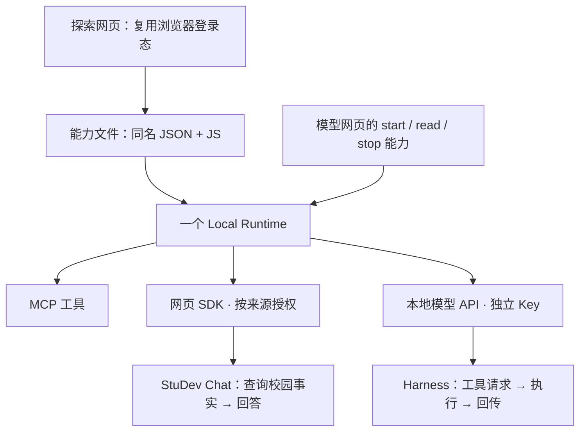

# Local Runtime：工具、网页与模型

Local Runtime 是同一个本地运行时的三种入口。MCP 让 Agent 调用本机和已注册网页能力；网页 SDK 让已授权的网站调用有限能力；模型接口让 Harness 和原生应用使用浏览器里的模型。运行时不接管 Agent 循环：工具执行、结果回传和下一步决策仍归 Harness 或应用。



## 能力注册

`capabilities/deepseek/start.json` 和 `start.js` 定义同一个能力 `deepseek.start`；另外两对文件定义读取和停止。文件树就是注册表，启动时读取并校验，没有额外清单或数据库。JSON 描述来源范围、输入输出和副作用；JS 是接收 `input` 的完整函数表达式。详见 [能力目录说明](../capabilities/README.md)。

新增网站时，先用浏览器工具探索真实页面，再保存经过验证的原子能力。MOOC 是这种能力的一个应用场景，不是运行时的业务模型。不要把具体课程、校园事实或 Agent 任务循环放入通用内核。

## 配置与启动

参照 [配置示例](../config.example.yaml) 配置 `capabilities`、`models` 和 `grants`。目录相对配置文件解析；发布包附带能力文件。只有 `grants.web` 中启用了 `use: true` 的站点可以使用网页桥；网页只能指定能力名和输入。目标网址由本机配置确定，网页不能指定其他标签页、浏览器或任意脚本。

本机原生程序（如 Harness、StuDev Windows）通过 `grants.clients` 各自持有独立的受限凭据（可用 `lrmcp setup client --id harness --model deepseek-web` 生成，也可在单次子进程中提供 `LOCAL_RUNTIME_MCP_CLIENT_TOKEN` 或 `LOCAL_RUNTIME_MCP_CLIENT_TOKEN_<ID>`）。该凭据与浏览器连接凭据、本机/公网 MCP 凭据严格隔离，绝不能调用机控工具。不要把任何客户端凭据放入网站代码；网站通过扩展 SDK 访问。

```text
lrmcp serve --transport local
GET  http://127.0.0.1:9317/v1/models
POST http://127.0.0.1:9317/v1/chat/completions
Authorization: Bearer <client-scoped-token>
```

本机专属面（默认 `127.0.0.1:9317`）永不接入公网隧道，强制拒绝浏览器 `Origin` 与反代转发头，统一承载本机 `/mcp`、`stdio` 薄代理附着、`/v1/*` 与 `/capabilities/*`。公网隧道口（默认 `127.0.0.1:9316`）仅保留远端 `/mcp` 与 OAuth，不再暴露 `/v1/*` 与 `LocalApps`。

## 模型与工具闭环

调用方用稳定的 `conversation_id` 指定会话：Harness 使用自己的 Session ID，StuDev 使用当前聊天分支的 ID。第一次为它创建专用网页会话，后续消息和工具结果在同一个会话中追加。网页来源、模型和会话标识共同确定资源归属；不同网站不能用相同 ID 接续彼此的聊天。运行时不读用户未指定的旧聊天，不提取登录 Cookie，也不将网页凭据交给调用者。

同一会话串行执行，返回结果携带 `conversation_id`。调用方切换历史分支时显式使用新的分支 ID；上下文前缀不一致会返回冲突，不会悄悄改用别的聊天。失败或取消只停止当前轮次，保持该会话；重试须由调用方明确发起。`DELETE /v1/conversations/<id>?model=<model>` 或 SDK 的关闭操作结束运行时自己的会话资源，不删除模型网站上的聊天记录。

普通回答可以流式返回。带工具时，网页模型必须返回完整的结构化 JSON，运行时验证工具名、参数 schema 和工具选择要求后才转成标准 `tool_calls`。运行时不执行这些工具。Harness 或 StuDev 执行后，在下一次请求中携带工具结果。原始 DSML、Markdown 代码块和未通过校验的参数不能成为工具调用。

请求依次经过排队、页面准备、等待输出与生成。网页 SDK 的 `delta.stage` 与本地流的 `: stage <名称>` 注释分别报告 `queued`、`preparing`、`waiting`、`generating`。本地流看到正文或工具调用时才发出助手角色帧。

排队上限 25 秒，页面准备上限 35 秒，首个输出或连续两段输出之间的等待上限 60 秒。模型配置的 `timeout_seconds` 约束整轮。超时分别返回 `model_queue_timeout`、`browser_ready_timeout`、`model_first_output_timeout`、`model_output_stalled` 或 `model_timeout`。

适配器明确确认没有点击发送时，返回 `browser_composer_not_ready` 并保留此前的会话历史。用户可以重新提交这条尚未发送的消息。发送结果不明确时，运行时保留该轮归属，等待用户明确重试。取消与超时只对已尝试发送的轮次请求停止，轮次标识保护后续生成。

网页模型不提供可验证的采样、精确 token 上限、图片或完整 OpenAI 功能。本接口明确拒绝未实现的请求参数；不要把它当作官方 DeepSeek API。客户端适配应只提交支持的字段，不应偷偷忽略参数。Harness 集成使用官方 `LlmAdapter` 接口，避免通用供应商适配器强加网页无法控制的默认参数。
